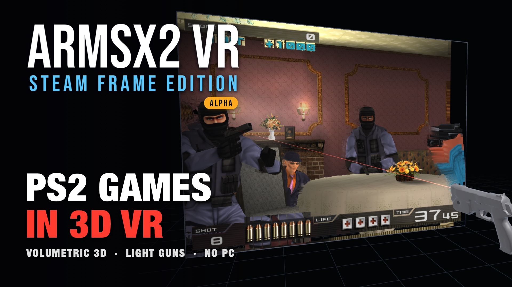

# ARMSX2 VR Steam Frame Edition

A standalone PlayStation 2 emulator for the Steam Frame. It runs entirely on the headset, so the Frame does not need to be connected to a PC to play: a computer is only used to install it and update it. It runs [ARMSX2](https://github.com/ARMSX2/ARMSX2) (an ARM64 fork of PCSX2) inside a native OpenXR app and shows the game on a virtual screen, either **volumetric** (the game drawn from each eye, so the world sits behind the screen like a window) or **flat**, switched at once from a button beside the screen. Light gun games are played with GunCon 2 guns held in the hands. Everything is driven from the headset: a settings menu, a game list, pause and quit buttons, controller mapping, HD texture packs and Wi-Fi transfer of games, BIOS files and texture packs (zip, 7z and RAR archives are unpacked on the headset).

[](https://youtu.be/cGu4wy_Wa-Q)

**▶ [Watch the trailer](https://youtu.be/cGu4wy_Wa-Q)** (1:01): volumetric 3D and the live switch from flat, the light gun from calibration to two guns, the menus in the headset, Wi-Fi transfer and the installer app.

The visual glitches in the trailer come from where the camera was placed for its shots; they do not show in the game.

## Thank You

This project is a fork of [ARMSX2](https://github.com/ARMSX2/ARMSX2), and we thank the ARMSX2 team for making it possible. ARMSX2 is itself built on the shoulders of the [PCSX2](https://pcsx2.net) project.

> [!WARNING]
> **Alpha.** This project is in its Alpha stage and is currently being tested. Expect bugs, crashes and settings that change between releases. The Steam library art carries an **ALPHA** badge until testing is done. If you try it, please report what went wrong, with the logs from `~/.local/share/ps2v/logs/`. Known gaps are in [Known limitations](#known-limitations).

## Contents

- [Getting started](#getting-started)
- [In the headset](#in-the-headset)
- [Settings menu](#settings-menu)
- [Game list](#game-list)
- [Wi-Fi transfer](#wi-fi-transfer)
- [Texture packs](#texture-packs)
- [Controller mapping](#controller-mapping)
- [Light gun](#light-gun)
- [Files and folders](#files-and-folders)
- [VR.ini reference](#vrini-reference)
- [Command line](#command-line)
- [How it works](#how-it-works)
- [Known limitations](#known-limitations)
- [Building from source](#building-from-source)
- [Recording trailer footage](#recording-trailer-footage)
- [License](#license)
- [Credits](#credits)

## Getting started

The game is not on the Steam store. You install it on the Frame from a computer on the same network, with the **[installer app](https://github.com/SPD13/arm-sx2-vr-steam-frame/releases/latest)**. The app finds the Frame and checks that it is ready. It then downloads the latest version of the game and installs it in the Steam library, with its name and artwork. The same app updates the game later. Nothing is installed on the computer itself.

### What you need

- A Steam Frame and a computer on the **same network**.
- A computer with **Windows 10 or 11** (64-bit), **macOS 12 or later** (Apple silicon or Intel) or **Linux**. Nothing else is needed: the installer app brings everything it uses.
- An internet connection: the app downloads the game (about 20 MB) from this repository's [releases](https://github.com/SPD13/arm-sx2-vr-steam-frame/releases). The Frame needs about 800 MB free while installing.
- Your own PS2 BIOS dump and your own games: none are included.

### 1. Turn on Developer Mode on the Frame

1. On the Frame, open **Settings > System** and turn on **Enable Developer Mode**.
2. In the **Developer** section that appears, choose **Set User Password** and pick a password. The installer asks for it.

Keep the headset on (or awake) while installing: it leaves the network when it goes to sleep.

### 2. Install the Steam Linux Runtime 4.0 ARM64

The game runs inside Valve's **Steam Linux Runtime 4.0 ARM64**. Steam does not fetch it by itself for games added outside the store, so install it once: in the Frame's Steam library, search for **Steam Linux Runtime 4.0** and install the ARM64 one. If it is missing, the game closes as soon as it starts.

### 3. Download the installer app

| Computer | Download |
| --- | --- |
| Windows 10, 11 | [ARMSX2-Frame-Installer-Windows.exe](https://github.com/SPD13/arm-sx2-vr-steam-frame/releases/latest/download/ARMSX2-Frame-Installer-Windows.exe) |
| macOS 12 or later | [ARMSX2-Frame-Installer-macOS.zip](https://github.com/SPD13/arm-sx2-vr-steam-frame/releases/latest/download/ARMSX2-Frame-Installer-macOS.zip) |
| Linux (PC, Steam Deck) | [ARMSX2-Frame-Installer-Linux-x86_64.tar.gz](https://github.com/SPD13/arm-sx2-vr-steam-frame/releases/latest/download/ARMSX2-Frame-Installer-Linux-x86_64.tar.gz) |
| Linux (ARM64) | [ARMSX2-Frame-Installer-Linux-arm64.tar.gz](https://github.com/SPD13/arm-sx2-vr-steam-frame/releases/latest/download/ARMSX2-Frame-Installer-Linux-arm64.tar.gz) |

These links always give the latest version; the files are also on the [releases page](https://github.com/SPD13/arm-sx2-vr-steam-frame/releases). You don't need a new installer for each new version of the game: it always installs the latest one.

### 4. Run the installer app

The app is not signed with a paid certificate, so Windows and macOS warn the first time it is opened:

- **Windows:** double-click `ARMSX2-Frame-Installer-Windows.exe`. If Windows says "Windows protected your PC", choose **More info**, then **Run anyway**. If the browser warns that the file is not commonly downloaded, choose to keep it.
- **macOS:** open the `.zip` (Safari may already have done it). You can move **ARMSX2 Installer** to your Applications folder; then double-click it. If macOS says it cannot verify the app ("Not Opened"), choose **Done**, open **System Settings > Privacy & Security**, scroll down to **Security**, choose **Open Anyway** next to the app's name and confirm. When the app asks to **find devices on local networks**, choose **Allow**: the app needs it to reach the Frame.
- **Linux:** unpack the download and run the app, for example in a terminal: `tar -xzf ARMSX2-Frame-Installer-Linux-x86_64.tar.gz && ./ARMSX2-Frame-Installer`. It opens in your web browser and quits when the page is closed.

The app has two steps.

**Step 1, connect to your Steam Frame.** The app looks for the Frame on the network and fills in its address. Type **the password set in step 1** and choose **Connect**. Four checks turn green:

1. **Frame found on the network**
2. **Developer Mode is on**
3. **Signed in to the Frame**
4. **Frame ready for the game** (Steam running, enough free space)

If a check turns red, it says what is wrong and what to do. For example, wake the headset, turn on Developer Mode, use the right password, or type the Frame's IP address in **Frame address** (the Frame shows it in **Settings > Network**). Fix it, then choose **Check again**.

**Step 2, install or update the game.** The app shows what is on the Frame and the latest version on GitHub. Choose **Install**. The app downloads the game and sends it to the Frame, with a progress bar, then lists each step of the installation. It ends with **Installed! Put the headset on and play.**

### 5. Play

On the Frame, open **Library > Non-Steam > ARMSX2 VR Steam Frame Edition**. While the project is in Alpha, its library art carries an **ALPHA** badge. If the library still shows plain artwork, restart the headset.

Put the headset on: the screen appears ahead of you, facing the room's forward direction (SteamVR's recenter sets it), and the game list opens.

### 6. Add your BIOS and games

1. You need your own PS2 BIOS dump. In the headset, open **Settings › Wi-Fi Transfer** and switch it on. Then open the address it shows in a browser on your computer or phone, and upload the BIOS in the **BIOS** tab. The emulator uses the first BIOS it finds in the folder.
2. Upload games in the **ROMs** tab. They appear in the game list. Zip, 7z and RAR archives are unpacked on the headset.

See [Wi-Fi transfer](#wi-fi-transfer) for more. To copy files over ssh instead, [Files and folders](#files-and-folders) lists where they go.

### Updating

Open the installer app again and connect (step 1). When a newer version is out, step 2 shows **Update available**, with a button **Update to &lt;version&gt;**: choose it. **Up to date** means there is nothing to do. Your games, BIOS files, memory cards, save states, texture packs and settings are kept.

### Uninstalling

In the installer app, after step 1, choose **Uninstall the game from the Frame...** at the bottom of step 2, then **Uninstall**. This removes the game, its library entry and its artwork. Tick **Also delete its settings, controller mapping, caches and logs** to remove those too. Your games, BIOS files, memory cards, save states and texture packs in `~/.local/share/ps2v` are never deleted.

### Troubleshooting

| Problem | What to do |
| --- | --- |
| The Frame is not found, or "No answer from" its address | Wake the headset (put it on). Check that the Frame and the computer are on the same network: a guest Wi-Fi often keeps devices apart. Check that Developer Mode is on. Type the Frame's IP address in **Frame address**. |
| "The Frame does not accept connections" | Developer Mode is off: turn it on (step 1). |
| "The password was refused" | Type the password set in **Settings > Developer > Set User Password** (it is case sensitive), or set a new one there. |
| "The Frame's identity has changed" | This is expected after the Frame was reset or reinstalled: choose **Trust the Frame's new key**. |
| "Steam is not running on the Frame" | Put the headset on so it starts in its normal mode, then choose **Check again**. |
| "Not enough free space" | Uninstall a game or delete files on the Frame, then choose **Check again**. |
| macOS: the app "cannot be opened" or is "Not Opened" | **System Settings > Privacy & Security > Open Anyway** (see step 4). If it cannot find the Frame, allow it in **System Settings > Privacy & Security > Local Network**. |
| The game is missing from the library | Look under **Library > Non-Steam**. Restart the headset if it is still missing. |
| The game closes at once | Check that the Steam Linux Runtime 4.0 ARM64 is installed (step 2). Otherwise, read the game's log on the Frame: `ssh steamos@frame.local cat .local/share/ps2v/logs/ps2v.log` (the emulator's own log is `emulog.txt` beside it). |
| Something else | [Report the problem](https://github.com/SPD13/arm-sx2-vr-steam-frame/issues/new?template=bug_report.yml) with the logs: see [Reporting a problem](#reporting-a-problem). |

### Reporting a problem

The project is in Alpha, so reports help a lot. Right after the problem, before starting the game again (it keeps the logs of its last run only), open the installer app, connect (step 1), and choose **Save the logs** under **Report a problem**. It saves a `.zip` in your Downloads folder and shows it. The zip holds the game's logs and settings from the Frame and the installer's own log; lines holding a password or a token are left out of the settings. Then choose **Open a bug report on GitHub**, fill in the form and attach the zip.

Without the installer, copy the logs from `~/.local/share/ps2v/logs/` on the Frame: `scp steamos@frame.local:.local/share/ps2v/logs/*.* .`

Developer Mode stays on after the install: the installer needs it to install and update the game. Nobody has checked yet whether the game keeps working with Developer Mode turned off again.

## In the headset

Round buttons sit just outside the screen, on its right side, so they never cover the game: a group from level with its top down, the 3D and passthrough buttons at mid height, and pause and power at the bottom:

| Button | Does |
|---|---|
| ⚙ Gear | Opens the [settings menu](#settings-menu) |
| 🎮 Gamepad (below the gear) | Opens the [game list](#game-list) |
| 🔫 Gun (after a gap below the gamepad) | Turns [light gun](#light-gun) mode on or off for the running game: the controllers are the GunCons or the DualShock 2; lit while on. The guns stay plugged in either way |
| 👤 One / 👥 two people (below it) | One gun or two; only while light gun mode is on |
| ▣ Cube / ■ square (at mid height) | Switches the [3D mode](#3d) at once, in turn: **Flat** (square), **Volumetric** (cube, lit) and **Volumetric+** (cubes, lit) |
| 👁 Eye (below the cube) | Switches [passthrough](#display) at once: your room around the screen (eye, lit) or the dark void (crossed-out eye). Greyed when SteamVR offers no passthrough |
| ⏸ Pause (bottom, above power) | Pauses or resumes the game; lit (a play icon) while paused. Menus opened meanwhile leave it paused, and another game starts unpaused |
| ⏻ Power, red (bottom, level with the screen's bottom edge) | Asks "Quit ARMSX2 VR?" and quits on **Quit**; while a game runs, **Reset** instead starts it over (a console reset, same disc) |

- **Pointing.** As soon as a controller points away from the game picture, its beam shows, with a dot where it meets the screen's plane; while a menu is open the beam is always out. Only the controller you clicked with last is the pointer; the other one takes over when you pull its trigger.
- **Clicking.** Pull the trigger. A trigger is a menu click whenever a menu is open or the pointer is on one of the buttons; only otherwise does it act as the game button it is mapped to (L2 / R2 by default). Pulling the trigger off the screen anywhere but on a button still reaches the game, so light gun games still reload by shooting off-screen.
- **Pausing.** Opening a menu pauses the game; closing it resumes, unless you paused it with the pause button.
- **Closing a menu.** Its ✕ button, or a click anywhere off the panel. Starting or loading a game closes it too.
- **Moving between menus.** While a menu is open, the gear, the gamepad and the power button stay beside it, on the welcome screen and in a game alike; the open menu's button is lit. Click another to go straight to its menu. The lit one goes back to the game when one runs (its tooltip says so). With no game running, closing the settings goes back to the game list.
- **Emulator messages.** The emulator's own messages (warnings at boot, "Saving screenshot"…) show in boxes above the screen, never in the game's picture, and go away after a few seconds.
- **Scrolling** the game list: either thumbstick, or drag its scroll bar.
- **Recentering.** Click both thumbsticks together, or use **Settings › Display › Recenter**.

## Settings menu

A navigation bar on the left lists the categories, with **Exit** last.

### Display

| Option | Range | Notes |
|---|---|---|
| Screen size | 1.0 – 4.0 m wide | Applies at once. Saved in `VR.ini`. |
| Screen distance | 1.0 – 5.0 m | The screen slides along its axis. Saved in `VR.ini`. |
| Passthrough | on · off | Shows your room, through the headset's cameras, around the screen instead of the dark void (default off). Applies at once, as the eye button beside the screen. Your last choice, here or with the button, is saved in `VR.ini` (`[Mode] passthrough`) and kept at the next start. |
| Recenter | button | Places the screen straight ahead of where you look. |

### 3D

| Option | Values | Notes |
|---|---|---|
| 3D mode | Flat · Volumetric · Volumetric+ | **Volumetric** draws the game from each eye, so the world sits behind the screen like a window. **Volumetric+** *(test)* gives the world behind the window its full depth, at a fixed size in the room: the farthest scenery is at infinity, and leaning in shows more of the world around the edges, as through a real window. **Flat** shows a flat picture. Applies at once (the game pauses for a moment), as the cube button beside the screen. |
| Depth | 0 – 5 m | How far behind the screen the farthest scenery appears (default 3 m). Not in Volumetric+, whose depth comes from the screen distance. |
| Screen plane *(advanced)* | 0.01 – 1 | Which depth in the scene (the game's normalised Z) sits on the screen glass. Set it so the nearest objects just touch the glass. Default 0.12, for Time Crisis II. |

Volumetric draws both eyes (multiview). Flat draws one picture the way stock ARMSX2 does, without the per-eye rendering, so it keeps stock compatibility. The modes switch live: the game pauses for a moment while the emulator rebuilds its render targets. Volumetric+ is an experiment and may go away; how it differs from Volumetric is in [`docs/fixed-scale-parallax.md`](docs/fixed-scale-parallax.md#volumetric-the-true-portal-in-the-multiview-path).

### Graphics

| Option | Values | Stored in |
|---|---|---|
| Internal resolution | Native · 2x · 3x · 4x | `PCSX2.ini`, `[EmuCore/GS] upscale_multiplier` |
| Texture filtering | Nearest · PS2 · Smooth | `PCSX2.ini`, `[EmuCore/GS] filter` (0, 2, 1) |
| Blending accuracy | Minimum · Basic · Medium · High | `PCSX2.ini`, `[EmuCore/GS] accurate_blending_unit` (0 – 3). Minimum by default: higher levels draw some effects piece by piece, which made Time Crisis II's gunfights stutter |
| Performance window | on · off | `VR.ini`, `[Graphics] performance_window`. Off by default. A window left of the screen: the game's and the headset's frame rate, the emulator's CPU threads (core, GS, VU1 with MTVU) and its GPU use, each as a 2-second average and a graph of the last 3 minutes |

Both apply while the game runs. Settings that only one renderer supports, or that could break the stereo rendering (renderer choice, aspect ratio, widescreen patches, deinterlacing), are left out on purpose.

### Texture Packs

The core's texture replacement settings, as ARMSX2's Android and iOS apps offer them, then the games that have a texture pack.

| Option | Values | Stored in |
|---|---|---|
| Texture packs | on / off | `PCSX2.ini`, `[EmuCore/GS] LoadTextureReplacements`. Off at first; adding a pack over Wi-Fi turns it on, as ARMSX2 does when it installs one. |
| Load in the background | on / off | `PCSX2.ini`, `[EmuCore/GS] LoadTextureReplacementsAsync` (on): the game runs on while textures load, and they show a moment later. |
| Preload | on / off | `PCSX2.ini`, `[EmuCore/GS] PrecacheTextureReplacements` (off): the whole pack is loaded as the game starts. |

Under them, **Games with a texture pack**: one row per pack with the game's title (from the game list, else PCSX2's game database), its serial, how many textures and how much space. The running game's row says **Playing**. The 🗑 removes a pack after a confirmation; the game itself stays. The thumbsticks scroll the list. See [Texture packs](#texture-packs).

### Audio

| Option | Range | Stored in |
|---|---|---|
| Volume | 0 – 100 %, steps of 5 | `PCSX2.ini`, `[SPU2/Output] StandardVolume` |
| Mute | on / off | `PCSX2.ini`, `[SPU2/Output] OutputMuted` |

### Game

- **Save slot** 1 – 5, showing when each slot was saved or that it is empty.
- **Save** writes the running game to the slot. **Load** restores it and closes the menu.
- **Restart game** resets the console, after a confirmation.

Save states are per game, in PCSX2's save state folder.

### Wi-Fi Transfer

| Option | Notes |
|---|---|
| Wi-Fi transfer | Starts or stops the web server. Off each time the app starts. |
| Access code | The page asks for a 6-digit code shown here. On by default; saved in `VR.ini`. |
| New code | Makes a new code and signs every browser out. |

While it runs, the page shows the address to open (for example `http://192.168.1.20:8080`), the code in large type, and the progress of an upload. See [Wi-Fi transfer](#wi-fi-transfer).

### Controls

Two tabs: **DualShock 2**, its 18 controls with the controller input each one has, and **GunCon**, the 13 controls of gun 1 or gun 2. **Reset to defaults** resets the set shown (not the colours).

Under the GunCon controls, the gun's colour, from gray, black, white, red, blue, green, orange and purple; it applies at once. Gun 1 has one colour for playing alone (gray by default) and one for two players (red); gun 2 has one (blue). The trigger stays black and the side buttons red. Any other colour can be set in `VR.ini`. See [Controller mapping](#controller-mapping).

**Gun Beam** (on by default), in the GunCon tab below the controls, shows the laser beam from the gun's muzzle; off, only the dot where it lands shows. It applies to both guns, and is the same setting as **Beam** on the Light Gun page.

**GunCons Plugged** (on by default) plugs the GunCon 2 guns into the console's USB ports, one or two as the Light Gun page's **Guns** says, in every game; off, the game sees no gun. It applies at once, in the running game too. Light gun mode does not plug or unplug them: it only decides whether the controllers are the guns or the DualShock 2.

**Show VR Controllers** (on by default) shows your controllers in the headset, as SteamVR's own Steam Frame controller models, with their buttons, triggers, grips and sticks moving as you press them. In light gun mode a hand holding a gun shows the gun instead; with one gun, the other hand still shows its controller. The models are read from the SteamVR install (`/opt/steamvr` on the Steam Frame); without them, no controllers are shown.

### Light Gun

| Option | Values | Notes |
|---|---|---|
| Light gun mode | Auto · Off · On | For the running game, as the gun button. **Auto** is on for the games the emulator knows as GunCon 2 games (and those whose profile says `lightgun = 1`). Saved per game in `lightgun.ini`. |
| Guns | One gun · Two guns | Two: one in each hand, for two players. As the people button. |
| Gun hand | Right · Left | The hand that holds gun 1. |
| Beam | Beam and dot · Dot · Off | What shows where the gun points. On a menu or a button the dot always shows. **Gun Beam** under Controls › GunCon switches between the first two. |
| Pedal button | A · B · C | The gun button the pedal input presses: the one the game takes cover with. |
| Recoil | Off – 100 % | Strength of the controller's pulse on each shot. |
| Gun angle | −30° – 30° | Tilts the gun in your hand, and its aim with it. |
| Calibration | Calibrate · Reload | Done once the menu has closed: Time Crisis's calibration shot, or a shot off the screen. |

### Exit

Quits the emulator after a confirmation, which also offers **Reset** while a game runs: the game starts over, as a console reset does. Either way, progress since the last save is lost.

## Game list

The gamepad button opens the list of games in the games folder (`roms/`), with five tabs:

| Tab | Shows | Order | Detail line |
|---|---|---|---|
| All | every game | title | serial · size |
| Recently Added | every game | newest file first | "Added today at 14:32" |
| Recent Play | games played at least once | last played first; the running game on top | "Last played yesterday at 08:02" |
| Most Played | games played at least once | total play time | "Played 4 h 31 min" |
| Favorites | starred games | title | serial · size |

- **Favourites.** Click the ☆ next to a game to star it (it turns gold); click again to remove it. Kept in `favorites.txt`.
- **HD.** A game with an HD texture pack installed (see [Texture packs](#texture-packs)) has an **HD** badge after its title.
- **Starting a game.** Click its row. If another game is running, a popup asks first, since progress since the last save is lost. Clicking the running game just resumes it.
- **Restarting.** The running game's row has a **Restart** button: after a confirmation (its current state and play since the last save are lost) the console resets and the game starts over. Time Crisis then shows its GunCon 2 calibration screen again.
- **Starting without a game.** `ps2v` without a disc image starts with no game and opens the list. A game that fails to start brings the list back with the reason.
- **Where the data comes from.** Titles, serials and play time come from PCSX2's game list (play time is recorded when a game stops). A running game keeps the disc drive locked, so the list cannot rescan until it stops: games added meanwhile appear under their file name and get their real title afterwards.
- **"Added"** is the file's inode change time, which an upload, copy or move into the folder sets even when the copy keeps the original modification date. Renaming a file, or changing its permissions, counts as adding it again.
- PS1 discs are not listed: the emulator cannot run them.

## Wi-Fi transfer

Manage the BIOS, game and texture pack folders from any computer or phone on the same network.

1. In the headset: **Settings › Wi-Fi Transfer**, switch it on.
2. In a browser: open the address shown (port 8080, or the next free one up to 8089) and enter the code if asked.
3. Pick the **BIOS**, **ROMs** or **Texture Packs** tab.

While it runs, a line below the screen says **Wi-Fi server ON at http://…**; clicking it opens the Wi-Fi Transfer page (for the code, or to switch it off). It stays on across launches: on when the app closed, it starts again the next time (`web_enabled` in `VR.ini`).

The page shows the files in that folder (name, size, date added) and the space left on the headset. You can:

- **Upload**: choose files, or drag them onto the page. Several files go one after another, each with a progress bar and its speed. A file with a name that is already there asks before replacing it; a file that would not fit is refused before it is sent.
- **Delete**: the 🗑 next to a file, after a confirmation. The running game cannot be deleted.

| Folder | Accepted files |
|---|---|
| BIOS | `.bin .rom0 .rom1 .rom2 .erom .mec .nvm`, and `.zip .7z .rar` archives |
| ROMs | `.iso .chd .cso .zso .gz .bin .cue .img .mdf .mds .nrg .elf`, and `.zip .7z .rar` archives |
| Texture Packs | `.zip .7z .rar` archives (see [Texture packs](#texture-packs)) |

Uploads are written to a hidden `.part` file and renamed when complete, so an interrupted upload leaves nothing behind. The headset keeps at least 64 MiB free.

**Archives.** A zip, 7z or RAR (RAR4 and RAR5) archive is unpacked on the headset and then deleted; the page shows the unpacking's progress. In the BIOS and ROMs tabs, the files of the tab's kinds go straight into the folder, wherever they are in the archive (a cue sheet and its bins stay together), and everything else in it (readme, nfo…) is left out. If files with those names are already there, the page asks before replacing them; the running game is never replaced. Password-protected and multi-volume archives are not supported. Archives are received and unpacked in `transfer/`, on the same disk, and only then moved into place.

### Security

The server is meant for your own network only:

- **Local clients only.** Connections from outside the private IPv4 ranges (10.x, 172.16–31.x, 192.168.x, 169.254.x, 127.x) are dropped.
- **No DNS rebinding.** The page only answers when it is opened by an IP address, `localhost` or a `.local` name, so a web site cannot point its own domain at the headset.
- **No cross-site requests.** Uploads, deletes and sign-ins need a custom header that pages from other sites cannot send.
- **Access code.** Optional, 6 digits, new each time the server starts. After 5 wrong codes a device is held off for 30 seconds, longer with each further miss. A signed-in browser keeps an `HttpOnly`, `SameSite=Strict` session cookie until the code changes.
- **Safe file names.** Names cannot contain paths, start with a dot or carry control characters, and each folder only takes its own file types.

It is plain HTTP: the code and the files cross your network unencrypted, as with most LAN tools. Switch the transfer off when you are done.

## Texture packs

HD texture packs replace a game's textures with redrawn ones. They work the way they do in ARMSX2 (and PCSX2): a pack belongs to one game, by its serial, and its files are in `textures/<serial>/replacements/`, where the core looks for them. The core loads PNG, DDS, ASTC and KTX textures.

**Adding a pack.** In the **Texture Packs** tab of the Wi-Fi transfer page, drop the pack's `.zip`, `.7z` or `.rar`. It is unpacked with ARMSX2's rules (the iOS app's `TexturePackPaths.h`, shared with its Android app), so a pack ends up with the same files as on ARMSX2's phone apps:

- **Which game.** The game picked in the **For** list beside the drop zone, if one is. Otherwise a serial folder in the archive (`SLUS-20219/…`), else a serial in the archive's name (`Time Crisis 2 slus_202.19 HD.zip` is SLUS-20219). If neither says, the page asks which game it is for: a game of your library (the running one first), or a serial typed in.
- **Which files.** The wrappers a pack comes in are dropped (`<serial>/`, `<serial>/replacements/`, a GitHub download's root folder), and only texture files are kept. Folders inside the pack stay.
- **Merging.** The files go over the game's existing pack: an add-on keeps its base pack, and a newer version of a pack replaces its files.
- **Refused.** An archive with a path that leaves its folder (`../`), a link, two files for the same texture (letter case aside), more than 100,000 entries, or a single file over 512 MB, as ARMSX2 refuses them. Nothing is installed then.

Adding a pack turns **Texture packs** on (as ARMSX2 does), and when it is for the running game, the game picks it up at once.

**Seeing and removing packs.** The tab lists the packs with their game, their serial, a **Playing** badge on the running game's and "not in your games" when no game of the library has that serial (a pack made for another region of the game, say: upload it again with your game picked in **For**). The 🗑 removes a pack. In the headset, **Settings › Texture Packs** lists the same packs and removes them too. Texture dumps, if any, stay in `textures/<serial>/`.

## Controller mapping

**Settings › Controls** lists every DualShock 2 control with the controller input it has. To change one:

1. Click the control.
2. A popup asks you to press what you want for it: a button, grip or trigger, or a stick for the two stick rows. It waits until you have let go of everything first.
3. The control takes that input. The control that had it takes the old input instead, or **Nothing** when another control still uses that one; map it again from the list.

The popup has no Cancel button, because a trigger press there is an input to map; it cancels by itself after 5 seconds. **Reset to defaults** restores the layout below.

### Default layout

| PS2 control | Steam Frame controllers | Touch-layout controllers |
|---|---|---|
| Cross / Circle | A / B (right) | A / B (right) |
| Square / Triangle | X / Y (right) | X / Y (left) |
| D-pad | Left D-pad | Left stick pushed all the way |
| L1 / R1 | Left / right grip | Left / right grip |
| L2 / R2 | Left / right trigger | Left / right trigger |
| L3 / R3 | Left / right stick click | Left / right stick click |
| Start | View button, tap | Menu button, tap |
| Select | View button, hold | Menu button, hold |
| Left / right analog stick | Left / right stick | Left / right stick |

Always, whatever the mapping:

- **Both sticks clicked** recenters the screen; the controls on the stick clicks are released meanwhile.
- **Start and Select on one input**: a tap is Start, holding it half a second is Select. The page shows them as "(tap)" and "(hold)".
- **Triggers** are menu clicks while a menu is open or the pointer is on a menu button, and game buttons otherwise.

Grips and triggers are analog: mapped to L1, R1, L2 or R2 they keep their pressure; on other buttons they press past half way.

## Light gun

In light gun mode each gun hand holds a light gun (a GunCon 2 to the game, plugged into the console's USB ports). Its trigger and side buttons move as you press them, and the gun stays steady in the hand however fast you move it or your head. Its colour is set under **Settings › Controls › GunCon**: by default gun 1 is gray when you play alone and red with two guns, and gun 2 is blue.

- **Aiming.** The beam leaves the gun's muzzle and ends in a dot where it lands. In Volumetric mode it goes into the window and stops on what you see there, so you shoot at the enemy, not at the glass in front of it (tried in Time Crisis II and Ninja Assault). Otherwise it stops on the screen glass. **Gun Beam** (Settings › Controls › GunCon) hides the beam and keeps the dot.
- **Shooting** off the picture is a reload, as with the real gun.
- **Menus.** The gun is also the pointer: aim it at a menu or a button and pull the trigger. A trigger pulled on the menu never fires in the game.
- **Recoil.** Each shot gives a short pulse in the controller.
- **Two guns.** With **Two guns**, the other hand holds gun 2 (USB port 2), with a blue beam (gun 1's is red), for two-player games. With one gun, the other hand's grip is the pedal.
- **Calibration.** Time Crisis games open a GunCon 2 calibration screen when they start with a gun plugged in: aim at the crosshair and pull the trigger, then press A to confirm. "Gun calibrated" shows below the screen when the game takes it. As on a real gun, the guns see no light while the picture is black, which is what the game checks after the shot; the emulator's messages are drawn above the screen, not in the picture, so they never light it. The **calibration shot** (Y by default, and **Calibrate** on the Light Gun page) does the same without that check. The emulator also knows the screen size of about 30 GunCon 2 games.
- **Turning it on and off.** The gun button switches light gun mode for the running game, and it is remembered for that game. Off, the controllers are a DualShock 2 again and the guns are put down: still plugged in, so the game never sees them go, but off the screen with nothing pressed. Switch back and forth as often as you like, for a game's menus say. Whether the guns are plugged in at all is **GunCons Plugged** under Settings › Controls (on by default); with it off, light gun mode shows "No GunCon plugged in". Only the guns in use are plugged in (a game asks to calibrate every gun it finds when it starts): switching to two guns plugs the second one in, which a game may only notice at its next start.

### GunCon controls

**Settings › Controls › GunCon** maps each gun's 13 controls like the DualShock 2's. Defaults:

| GunCon 2 | Gun 1 (right hand) | Gun 2 (left hand) |
|---|---|---|
| Trigger | Right trigger | Left trigger |
| A / B | A / B | Left grip / D-pad down |
| C | Right grip | D-pad up |
| D-pad | Left D-pad | — |
| Start | View button, tap | Left stick click |
| Select | View button, hold | — |
| Reload | — (shoot off the screen) | — |
| Calibration shot | Y | Left D-pad left |
| Pedal | Left grip | — |

The Steam Frame's left controller has no face buttons, so gun 2 uses its grip, D-pad and stick click. An input both sets use shows a `*`: with two guns it works gun 2 only. **Gun hand: Left** swaps the hands.

## Files and folders

Everything lives in the data folder, `$XDG_DATA_HOME/ps2v` (by default `~/.local/share/ps2v`):

| Path | What |
|---|---|
| `inis/PCSX2.ini` | Emulator settings (graphics, audio and the rest of PCSX2's options) |
| `inis/VR.ini` | Screen, 3D and Wi-Fi transfer settings, see [VR.ini reference](#vrini-reference) |
| `inis/Controls.ini` | Controller mapping: `[Pad1]` for the DualShock 2 (`cross = a`, `select = menu`, `left_stick = left_stick` …), `[GunCon1]` and `[GunCon2]` for the guns (`trigger = right_trigger`, `calibrate = y`, `pedal = left_grip` …) |
| `inis/lightgun.ini` | Light gun mode per game, by serial, when you chose it: `[Games] SLUS-20219 = true` |
| `inis/favorites.txt` | Favourite games, one path per line |
| `inis/playtime.dat` | Play time per game (PCSX2's) |
| `bios/` | PS2 BIOS dumps (Wi-Fi transfer's BIOS tab) |
| `roms/` | Games (Wi-Fi transfer's ROMs tab; the game list scans it, subfolders included) |
| `textures/<serial>/replacements/` | Texture packs, one per game (Wi-Fi transfer's Texture Packs tab) |
| `transfer/` | Archives being received and unpacked by the Wi-Fi transfer; emptied when it starts |
| `sstates/` | Save states |
| `profiles/<serial>.ini` | Your own per-game profiles; they take precedence over the ones shipped next to the binary |
| `logs/emulog.txt` | Emulator log |

## VR.ini reference

`VR.ini` holds the VR side's settings. The menu saves what you change a second after you change it. You can also edit the file by hand while the app runs: changes are picked up within a second.

Values are read in this order, each overriding the one before: built-in defaults, `VR.ini`, then the command line. Command-line values apply to that run only and are never written to the file, unless you change the same setting in the menu.

| Section | Key | Default | Range | Command line | Applies |
|---|---|---|---|---|---|
| `[Screen]` | `screen_width` | 2.4 | 0.3 – 10 m | `--screen-width` | live |
| | `screen_distance` | 2.2 | 0.3 – 10 m | `--screen-distance` | live |
| `[Mode]` | `stereo` | true | true volumetric, false flat | `--flat` | live |
| | `stereo_plus` | false | true for Volumetric+ (with `stereo`) | `--volumetric-plus` | live |
| `[Stereo]` | `stereo_depth` | 3.0 | 0 – 20 m | `--stereo-depth` | live |
| | `stereo_convergence` | 0.12 | 0.01 – 1 | `--stereo-conv` | live |
| `[Web]` | `web_enabled` | false | | | at launch (Wi-Fi transfer on when the app last closed) |
| | `web_require_code` | true | | | live |
| `[Controllers]` | `show_controllers` | true | | | live |
| `[LightGun]` | `gun_players` | 1 | 1 – 2 | | live |
| | `guns_plugged` | true | | | live (plugs the guns in or out of the running game) |
| | `gun_left_hand` | false | | | live |
| | `gun_beam` | 0 | 0 beam and dot, 1 dot, 2 off | | live |
| | `gun_pedal` | 0 | 0 A, 1 B, 2 C | | live |
| | `gun_haptics` | 0.6 | 0 – 1 | | live |
| | `gun_pitch` | 0 | −45 – 45° | | live |
| | `gun_color` | `#8c8c91` | `#rrggbb`: gun 1, one player | | live |
| | `gun_color_2p` | `#c0282d` | `#rrggbb`: gun 1, two players | | live |
| | `gun2_color` | `#2f5fd0` | `#rrggbb`: gun 2 | | live |

Numbers outside their range are clamped. `[Stereo]` settings apply in volumetric mode.

## Command line

```
ps2v [options] [disc image]
```

Without a disc image, the game list opens.

| Option | |
|---|---|
| `--bios-only` | Boot the BIOS without a disc |
| `--no-fast-boot` | Run the BIOS intro before the game |
| `--upscale N` | Internal resolution multiplier, 1 – 8 (saved to `PCSX2.ini`) |
| `--screen-width M`, `--screen-distance M` | Screen size and distance, for this run |
| `--flat`, `--volumetric-plus`, `--stereo-depth M`, `--stereo-conv F` | Start in flat mode or Volumetric+; volumetric depth and screen plane, for this run |
| `--sdl-pad` | Drive pad 1 from the first SDL gamepad (testing without the headset) |

Debugging only:

| Option | |
|---|---|
| `--no-menu-pause` | Keep the game running while a menu is open |
| `--load-state FILE` | Start from a save state; `SIGUSR1` saves `debug/state.p2s`, `SIGUSR2` writes a frame snapshot and both eyes' pictures |
| `--depth-trace`, `--depth-log-ms N` | Log the colour and depth targets of 3D draws (and every draw of one frame in 300), and every 3 s what the guns' depth grid holds (normalised Z percentiles, how much is at or nearer than the glass); how often to log where the eyes are |
| `--capture DIR`, `--capture-now`, `--capture-width N`, `--capture-max-gb G` | Trailer capture (see [Recording trailer footage](#recording-trailer-footage)): arm it into a new folder, record from the start instead of on the record button, scale the pictures down to `N` pixels wide, stop at `G` GB (default 40) |
| `--gun-script SHOTS` | In light gun mode, gun 1 fires by itself: `T:U:V` shoots at `U,V` of the picture (0 – 1, top left origin) `T` seconds after the game starts, `T:off` shoots off the screen, `T:a`, `T:b`, `T:c`, `T:start`, `T:cal` tap that gun button (`cal`: the calibration shot, at the centre); comma separated, e.g. `20:0.5:0.5,22:off`. For aimed shots the pedal is held from a second before the first one |

## How it works

The host code is in [`host/`](host); ARMSX2 is the submodule [`external/armsx2`](external/armsx2) (our fork, branch `ps2v`).

| Area | Files | Notes |
|---|---|---|
| Settings | `Settings.{h,cpp}` | `VrSettingsStore`: a table of settings layered from defaults, `VR.ini` and the command line, saved after a change settles, reloaded when the file is edited. `main.cpp` applies changes live. |
| Menus | `ui/` | Drawn on the CPU (`Canvas`, `Font` with stb_truetype, `Gui`, an immediate-mode widget set) and shown as alpha-blended OpenXR quad layers (`OverlayLayer`). PCSX2's ImGui context is a process-wide global that its GS threads drive, so the XR thread cannot run an ImGui frame of its own. A full menu redraw takes under half a millisecond and only happens when something visible changes. SteamVR on the Steam Frame allows 16 quad layers and 16 swapchains: the panel has its own swapchain, and every other menu quad (button groups, tooltip, notice, Wi-Fi line, emulator messages, beam, dot, and the invisible quad that keeps layers in their place in the list) is a part of one atlas image (`OverlayLayer::Part`), uploaded at most once a frame. That makes 8 swapchains in all; the layers are all in use. |
| Menu in the headset | `ui/VrMenu.{h,cpp}` | The buttons beside the screen and their tooltips, the panel and moving between panels, the pointer (controller aim poses), pausing, keeping menu clicks from the game, and the emulator's messages above the screen. |
| Pages | `ui/SettingsMenu.{h,cpp}`, `ui/GameListMenu.{h,cpp}` | The settings categories, and the game list. |
| Controllers | `XrApp.{h,cpp}`, `Controls.{h,cpp}` | `XrApp` reports the controllers as they are (one OpenXR action per button, grip, trigger and stick); `ControlMap` turns that into the DualShock 2 state. |
| Wi-Fi transfer | `web/` | `WebServer`, a small POSIX HTTP server; the page `web/index.html` is embedded into the binary at build time by `web/embed.cmake`. An archive that needs an answer (files to replace, which game a pack is for) waits unpacked in `transfer/` for up to 30 minutes, at `/api/pending/<id>`. |
| Archives and texture packs | `Unarchive.{h,cpp}`, `TexturePacks.{h,cpp}` | `Unarchive` reads zip, 7z and RAR with libarchive (built static by `tools/build-frame.sh`: the Steam Runtime has none). `TexturePacks` lists, installs and removes packs in the core's texture folder with ARMSX2's path rules, from the fork's `platforms/ios/.../IOS/TexturePackPaths.h`. `Emu::TexturePackChanged` reloads the running game's pack as the core's Reload Texture Replacements hotkey does. |
| Light gun | `gun/` | `GunModel` loads `assets/lightgun.glb` with cgltf; `GunRenderer` draws the guns, beams and dots per eye and shows each eye's picture on quad layers last in the list (SteamVR puts quad layers over projection layers, so the guns are not a projection layer); `GunView` fits a quad that stands still in the room between the eye and the guns, drawn through from wherever the eye is. SteamVR applies a quad's new pose a frame after its picture, so each eye has two quads: the one showing the guns never moves, and the other is fitted while empty and takes over the next frame when the guns near an edge; `GunAim` finds where a beam lands (the glass, or in volumetric mode the surface behind it, marched on `GunDepth`'s grid of the left eye's depth) and the pixel the GunCon reports; `GunLight` is the guns' light sensor: a black picture (under 2% of it lit) is no light, so the guns report off the screen; `GunGames` keeps the per-game mode. The core patch in `usb-lightgun/guncon2.cpp` (`usb_lightgun::SetHostState`) gives each USB port its own aim and buttons. The depth comes from the core (`GSRendererHW::SnapshotDepthBeforeDraw`): a frame's depth is copied before drawing moves to another colour target or wipes the depth, whether with a clear (Time Crisis II) or a full-screen draw at the far end of the depth range (Ninja Assault). |
| Trailer capture | `capture/`, `shaders/capture_*` | Only with `--capture`; without it nothing is created and each frame costs a null check. `TrailerCapture` copies each game frame's pictures, depth and HUD mask with compute passes into host-visible slots and hands them to `CaptureWriter`, whose five threads LZ4 them into one file per frame; it adds a line per headset frame (head, eyes, screen, guns, menus) and writes the menu images (`VrMenu::DescribeForCapture`) when they change. The file format is in `capture/CaptureFormat.h`. |
| Emulator | `Emu.{h,cpp}` | The CPU thread, PCSX2's host callbacks, and what the menus need: pause, settings, save states, the game list, switching games. The core hands its on-screen messages over (the fork's `ImGuiManager::SetOSDMessageHook`) instead of drawing them into the picture; `Emu::GetMessages` keeps them until they expire. Switching runs on the CPU thread, and resuming from a menu is skipped while a switch is under way so it cannot cancel it. |

## Known limitations

- **Alpha: only partly tested in the headset.** See the Alpha warning at the top; the rest was tested on a desktop, and the headset may still show things the desktop could not, such as runtime binding quirks or performance.
- If the runtime rejects the controllers' aim pose, the gamepad still works but menus cannot be pointed at. The log says "no aim pose …; the menu pointer is unavailable."
- In volumetric mode, both eyes may show the same picture while a menu has the game paused.
- Flat mode still has the emulator draw both eyes, so it costs as much GPU time as volumetric.
- Changing the internal resolution or texture filtering mid-game uses PCSX2's normal settings path, but has not been tried with the stereo changes to the renderer.
- The controller actions were renamed for mapping, so any SteamVR-side rebinding made for this app starts over.
- Wi-Fi transfer is plain HTTP, and whether SteamOS lets port 8080 through has not been checked.
- The game list cannot rescan while a game runs (see [Game list](#game-list)).
- **Light gun, not yet tried in the headset:** two-gun play, whether a game notices the GunCon 2 being plugged in or out mid-game (set GunCons Plugged before the game starts if not), the cost of the depth copies it turns on in volumetric mode, and GunCon 2 games other than Time Crisis II and Ninja Assault. A game's depth is found with rules that fit those two (see [How it works](#how-it-works)); in a game that draws its depth another way the beam may stop on the glass, and `--depth-trace` shows why. Ninja Assault uses little of its depth range, so its scenery sits near the back of the window.
- The guns see no light while the picture is black, as a real gun does: a shot fired during a fade to black counts as a shot off the screen (a reload in Time Crisis). Calibration with the trigger was only tried in Time Crisis II; the calibration shot (Y) works without the light check.
- In flat mode the beam stops on the glass.

## Building from source

The app is built on the Steam Frame itself (or any ARM64 Linux machine). The scripts below run from a computer with this repository checked out, and reach the Frame over ssh as `steamos@frame.local`. Developer Mode must be on and the Frame must accept your ssh key.

### Build

The build runs inside Valve's Steam Runtime 4 ARM64 SDK container, with rootless Podman:

```sh
tools/sync-frame.sh          # from your computer: mirror this repo to steamos@frame.local:ps2-volumetric/repo
# then, on the headset (ssh steamos@frame.local):
tools/build-frame.sh         # first run builds ARMSX2's dependencies into build/deps
```

The result is `build/frame/bin/ps2v`, with `resources/` (game database, shaders, fonts) and `profiles/` beside it. `FRAME_HOST` and `FRAME_DIR` change where `sync-frame.sh` copies to.

### Run

```sh
tools/run-frame.sh                    # opens the game list
tools/run-frame.sh path/to/game.iso   # starts a game directly
```

`run-frame.sh` starts `ps2v` inside the Steam Linux Runtime 4 ARM64 (install it from the Steam library) and logs to `~/.local/share/ps2v/logs/ps2v.log`. The emulator's own log is `~/.local/share/ps2v/logs/emulog.txt`.

### Install your build in the Steam library

The game installs in the Frame's Steam library as **ARMSX2 VR Steam Frame Edition**, with its artwork and icon from `assets/steam/`. While the project is in Alpha, that art carries an **ALPHA** badge; the same art without the badge is kept in `assets/steam-final/` for the first release after Alpha (see [`tools/steam-art/README.md`](tools/steam-art/README.md)). Players use the installer app (see [Getting started](#getting-started)). For development, `tools/steam-frame/deploy-to-frame.sh` builds on the Frame and updates that same library entry with the build, using the same steps. Releases, the installer app and the deploy script are covered in [`tools/steam-frame/README.md`](tools/steam-frame/README.md).

## Recording trailer footage

A trailer is a flat video, which loses the stereo of the volumetric view. So instead of filming the headset, the app can record what it shows, and `tools/trailer` rebuilds the scene behind the window on a Mac and films it with smooth camera moves, whose parallax shows the depth on any screen. This is a developer feature: it only exists when `ps2v` is started with `--capture` (the Steam library entry and the installer never pass it), so players have no record button and nothing is recorded.

**What a take holds** (a folder on the Frame, `~/ps2-volumetric/captures/<take>`):

- each game frame shown, as both eyes' pictures at the internal resolution;
- each eye's depth, and a HUD mask (where the HUD sits, so it stays on the glass);
- every headset frame: the head and eyes, the screen's placement, the light guns (pose, trigger, beam, shots) and the 3D mode;
- the menus as they showed: the open panel (game list, settings), the buttons beside the screen, tooltips, the Wi-Fi line, notices and the pointer;
- the headset's sound, recorded beside it.

**Recording**, from a computer with this repository (it starts the game over ssh; deploy a build first with `tools/steam-frame/deploy-to-frame.sh`):

```sh
tools/trailer/capture-frame.sh --name tc2 -- /home/steamos/.local/share/ps2v/roms/TimeCrisisII.iso   # or no disc: the game list first
tools/trailer/fetch-capture.sh tc2                                                    # to ~/ps2v-captures/tc2
```

In the headset the capture is armed but not recording. Calibrate the light gun and play to the scene to show; the **record button** (a circle under the passthrough button, only there with `--capture`) starts recording, turns red, and stops it again with a notice of the length. Record as many parts as you like, then quit with the power button. The record button and its notices are left out of the recording.

- Wear the headset (off the head SteamVR never places the screen, and both eyes come out the same), and switch to Volumetric before recording: Flat has no depth.
- In 3D at 3x upscale a take grows by about 40 GB a minute of recording (menus barely count: the game is paused). `--max-gb` caps it, and `--width 1280` roughly halves it. Copy it to a computer with that much free disk space.

**Rendering**, on a Mac (Swift and Metal, with ffmpeg):

```sh
cd tools/trailer/render && swift build -c release && cd -
tools/trailer/render/.build/release/trailer info ~/ps2v-captures/tc2     # the parts, 3D modes, shots, menus
tools/trailer/render/.build/release/trailer render my-trailer.json       # every shot, then a first cut
```

An edit list (start from `tools/trailer/trailer.example.json`) names the shots in order: camera moves through the window (`portal`, with presets `dolly`, `push`, `orbit`, `lean`, `gun` over the shoulder of the light gun, `menu` and `buttons` for the menus), the player's own view smoothed (`head`), Flat and Volumetric side by side (`compare`), a swing to the side that shows the scene as a diorama behind the glass (`reveal`), the two eyes' real pictures swapped (`wiggle`), title cards, captions, and outside clips such as screen recordings of the Wi-Fi transfer page or the installer app. Each shot comes out as a ProRes file with its sound for an editor, and `trailer.mp4` is a first cut with music under it. [`tools/trailer/README.md`](tools/trailer/README.md) has the details: every shot type and option, how the scene is rebuilt, and its limits.

## License

GPL-3.0-or-later, as ARMSX2 and PCSX2 are. Fonts and icons come from PCSX2's resources (Roboto, Font Awesome). The glTF loader is [cgltf](https://github.com/jkuhlmann/cgltf) 1.15 (MIT, `host/third_party/cgltf.h`). [`THIRD_PARTY_NOTICES.md`](THIRD_PARTY_NOTICES.md) holds the licences of the third-party code built into the game and the installer apps; it ships with every release.

## Credits

- Built with [Claude Code](https://claude.com/claude-code) by [SPD13](https://github.com/SPD13).
- The [ARMSX2 team](https://github.com/ARMSX2/ARMSX2), for ARMSX2, the ARM64 PS2 emulator this app runs.
- The [PCSX2 team](https://pcsx2.net), for PCSX2, the emulator ARMSX2 is built on.
- Johannes Kuhlmann, for [cgltf](https://github.com/jkuhlmann/cgltf), the glTF loader that reads the light gun model.
- [Khronos](https://www.khronos.org/openxr/), for OpenXR, the standard the whole VR side is built on.
- Sean Barrett, for [stb_truetype](https://github.com/nothings/stb), which draws the text in every menu.
- Tim Kientzle and the [libarchive](https://www.libarchive.org) contributors, for libarchive, which unpacks the zip, 7z and RAR files sent over Wi-Fi.
- [Font Awesome](https://fontawesome.com) and [Roboto](https://fonts.google.com/specimen/Roboto), the menu icons and text, from PCSX2's resources.
- Dharma Type, for [Bebas Neue](https://github.com/dharmatype/Bebas-Neue), the title lettering in the Steam library art.
- [Valve](https://www.valvesoftware.com), for the SteamOS devkit scripts that add the game to the Steam library, the Steam Linux Runtime it is built in and runs in, and SteamVR.
- The [webview](https://github.com/webview/webview) and [go-webview2](https://github.com/jchv/go-webview2) projects, for the installer app's window, and the [Go](https://go.dev) authors, for the language and the ssh and network libraries it uses.
