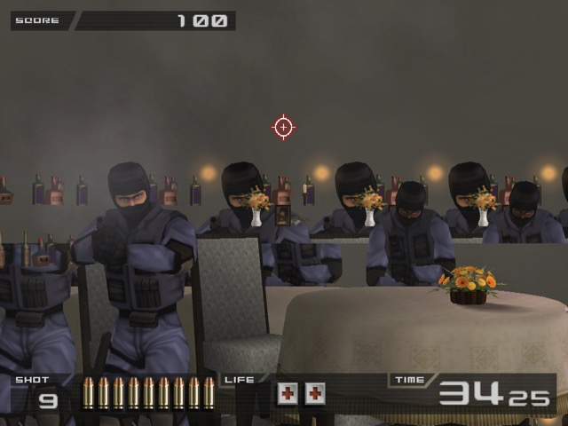
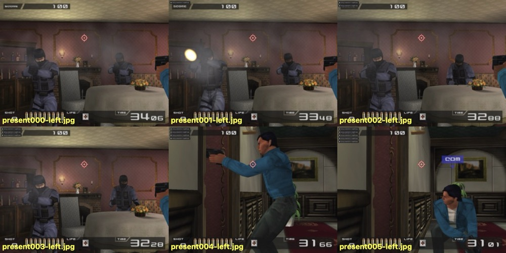
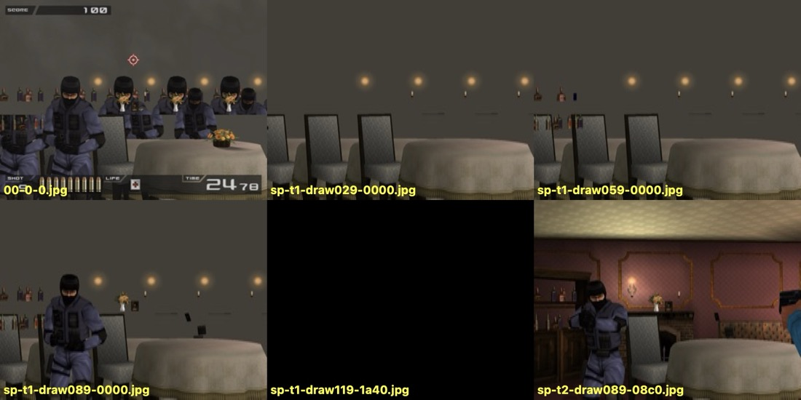
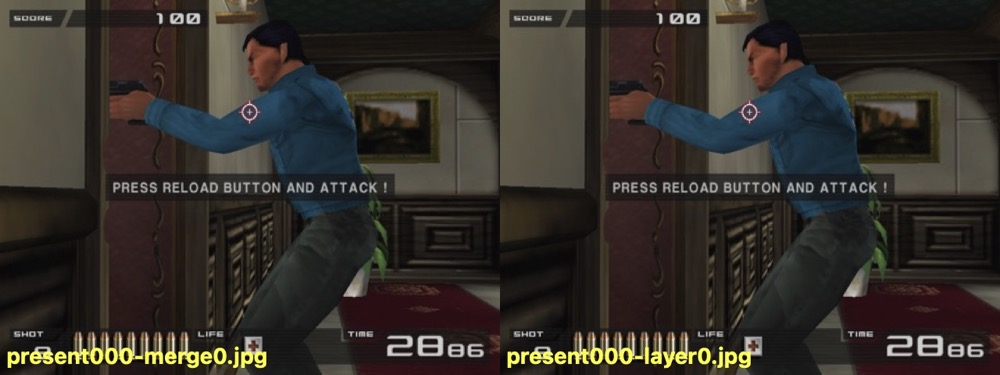

# M3: multiview stereo, and the wall-corruption bug (fixed 2026-10-12)

The geometric stereo prototype (`docs/m3-status.md`) drew alternate frames for each eye, so each eye only updated at 30 Hz. The multiview port draws **both eyes in every frame** at 60 Hz.

Multiview brought one serious bug: in Time Crisis II's first shooting room, walls disappeared and furniture was drawn several times over. **It is fixed.**

| | |
|---|---|
| **Symptom** | Some draws land in the wrong place: walls missing (gray), furniture duplicated side by side, sometimes green noise. Multiview only, in both eyes. |
| **Cause** | Inside a multiview render pass, the Turnip driver (Adreno 750, Mesa 26.3) does not reliably apply a new dynamic offset of the constant buffers to the following draws. Those draws keep an earlier draw's constants, including its vertex transform. |
| **Fix** | `GSDeviceVK::RestartMultiviewPassForNewConstants()`: in multiview, when the VS or PS constants change, the open render pass is ended and begun again in place (same framebuffer, contents loaded). |
| **Cost** | Nothing measurable in TC2: 59.8 fps, GPU about 18%, same as before. |
| **Verified** | 8 of 8 automated runs clean against 5 of 8 broken without the fix; confirmed in the headset; 4 of 4 clean again after the debug code was removed. |

This document covers:

1. what was built;
2. the bug;
3. the fix, how it works and why;
4. how to reproduce the bug without a person in the headset;
5. everything that was tested, in order, with the results and how reliable each one is;
6. lessons for the next bug hunt;
7. the debug tools left in the code;
8. open follow-ups.

Repos: `SPD13/armsx2-steam-frame` branch `ps2v` (the GS changes) and `SPD13/arm-sx2-vr-steam-frame` (host, tools, this document).

## 1. What was built

**Stereo modes:**

| Command line | What it does |
|---|---|
| `--stereo` | Multiview, the default. |
| `--stereo --stereo-alternate` | The old alternating-frame prototype. |
| no `--stereo` | Mono; the stereo code paths stay off. |

The multiview mode is selected through `GSVolumetric::StereoSettings::multiview` and fixed when the GS device is created. With multiview on, `GSDevice::m_stereo_layers` is 2.

**GS (fork):**

- **Textures.**
  - `GSTexture`/`GSTextureVK` can have array layers: a 2D_ARRAY main view, lazily created per-layer views, and "layer proxies". A proxy is a `GSTexture` that stands for one layer, shares the parent's image, and forwards layout and fence tracking to it.
  - `GetArrayView()` gives every texture a 2D_ARRAY view, including single-layer ones.
  - Uploads write every layer.
  - Barriers and clears cover all layers.
- **Allocation.** `GSDevice::FetchSurface` gives every render target, depth buffer and feedback target 2 layers. Textures stay single-layer unless they are copies of a two-layer target; the texture-cache copy sites and the RT clone pass the source's layer count.
- **Render passes and pipelines.**
  - TFX render passes are multiview (view mask 0b11, `VIEW_LOCAL` self-dependencies), and in-pass feedback barriers carry `VIEW_LOCAL`.
  - TFX shaders are compiled with `MULTIVIEW=1`. `tfx.glsl` samples every texture as an array (the eye's own layer, or layer 0 of a single-layer texture) and shifts vertices per view: left eye in `VRStereo.xy`, right eye in `VRStereo2.yz`.
  - The colour-clip setup/resolve and DATE prim-ID setup passes use a `MULTIVIEW` variant of `convert.glsl`.
- **Utility passes.** Stretch, multi-stretch, merge, interlace, FXAA, shade boost and DATE setup run once per layer, on proxies. Copies and blits copy every layer. CAS/FSR/SGSR are turned off with multiview.
- **Guard.** `CheckStereoRenderPass` logs any pass whose multiview-ness doesn't match its target's layer count. It never fired in testing.
- **Present.** The left eye is the normal present into the libretro backbuffer, sampling layer 0. `PresentRightEye` blits layer 1 into a second backbuffer using the same present geometry. Both are published through `VKLibretro::Frame::right_image`.
- **Which draws get the parallax shift.** Only draws into the displayed framebuffers (recent `DISPFB` bases) are shifted. The following are never shifted:
  - offscreen render targets. TC2 renders character shadows into a 128×128 target at 0x1a40 and textures 3D scenery from it;
  - draws that texture from a picture already holding per-eye content (`GSTexture::HasStereoContent`, which propagates through copies);
  - flat textured quads with Q exactly 1, unless (in Z mode) they are depth-tested against the scene (GEQUAL/GREATER) at a non-zero Z. Those are placed by their Z like any 3D draw. TC2 draws its wall-lamp halos as additive Q = 1 billboards at the lamp's depth; pinned, they floated in front of the wall;
  - full-width untextured fills;
  - HUDs stamped at the Z maximum, as before.
- **The fix** for the bug below (section 3).

**Host:** each eye's image goes to its own quad layer, so both eyes update every frame.

**Result in the headset (TC2):** both eyes at 60 Hz with smooth motion, the portal effect preserved, and the scene correct. Performance is about 58–60 fps, the same as the prototype.

## 2. The bug

**What you saw** (in the headset, and in the GS output itself, identically in both eyes):

- the room's walls were missing: gray, the fog/clear colour, showed through;
- tables, chairs, wall lights, bottles and vases appeared two or three times side by side;
- sometimes green noise covered part of the frame (uninitialized memory);
- it could last for seconds, or come and go.



The same scene in mono, from the same save state, is correct:



**Where and when:**

- Time Crisis II, first shooting room, right after stepping out of cover (the camera pans). The user located it in the headset: it appears when leaving cover.
- Without the fix it broke in about half of the runs (5 of 8 with the final harness). A run is either mostly broken or mostly clean.
- It was not seen in other scenes of the game.

**Only with multiview:**

| Mode | Result |
|---|---|
| mono | always correct |
| `--stereo-alternate` | always correct |
| `--stereo --stereo-depth 0` (multiview, zero parallax) | still broke |

So it was not the stereo shift.

**How it showed up inside a frame:** with sparse render-target saves in a broken run, the room's tables and chairs were already drawn three times side by side after the first 30 draws, with no walls. Draws put geometry in the wrong place.



## 3. The fix

### How the GS feeds constants to a draw

Each hardware draw writes its vertex-shader constants (vertex scale and offset, i.e. the screen transform, plus the stereo shifts) and its pixel-shader constants into streaming uniform rings. It then binds descriptor set 0 with **dynamic offsets** pointing at the new data (`vkCmdBindDescriptorSets`). Many draws of one frame share a render pass, so a pass normally contains a sequence of draws, each with new dynamic offsets.

### What goes wrong

In a multiview pass on Turnip, a draw after such a re-bind sometimes still reads the constants at an **earlier** offset. A draw that takes another draw's vertex transform puts its geometry in the wrong place. That is why furniture appeared offset and duplicated, and walls went missing because they were drawn elsewhere or off-screen. In mono and alternate mode the same command sequence is fine; only multiview passes are affected.

The evidence (section 5.5):

| Experiment | Runs with broken frames |
|---|---|
| Baseline (multiview, no fix) | 5 of 8 |
| End the render pass after **every** draw, without any GPU wait | 0 of 8 |
| End the pass **only when the VS constants change** | 0 of 8 |
| Re-bind descriptor set 0 (with the new dynamic offset) again inside the pass, before the draw | still broken |

A new pass reads the right offset; re-binding inside the same pass does not help. So the fault lies in how the driver carries constant-buffer offsets between draws inside a multiview pass. Our command stream is valid. A driver-side failure also fits the other observations: changing timing (GS thread delays, the capture layer) changed how often it happened.

### The code

`pcsx2/GS/Renderers/Vulkan/GSDeviceVK.cpp`:

```cpp
void GSDeviceVK::RestartMultiviewPassForNewConstants()
{
	if (!IsMultiview() || !InRenderPass())
		return;
	const VkRenderPass pass = m_current_render_pass;
	const GSVector4i area = m_current_render_pass_area;
	EndRenderPass();
	BeginRenderPass(GetRenderPassForRestarting(pass), area);
}
```

It is called from `SetVSConstantBuffer` and `SetPSConstantBuffer` when the cached constants actually change (`m_vs_cb_cache.Update()` / `m_ps_cb_cache.Update()` returns true). In mono or outside a pass, it does nothing.

- `GetRenderPassForRestarting` returns the same pass layout with its load ops set to *load* instead of *clear*, so the targets keep what was already drawn.
- The PS constants use the same dynamic-offset mechanism as the VS ones, so they get the same treatment. Only the VS-only variant was tested on its own (0 of 8); the shipped fix covers both.

### Cost

On a tiled GPU, a pass restart stores the tiles and loads them back. In TC2 this costs nothing measurable: 59.8 fps, GPU about 18%, the same as before the fix. A game that changes constants for almost every draw inside large passes could pay more, so check the GPU load per game when profiling.

### Verification

- 8 of 8 automated runs clean (5 of 5 dumps each), against 5 of 8 broken without the fix.
- No `CheckStereoRenderPass` reports and no new log errors.
- Headset: stepping out of cover and shooting, repeatedly, shows no corruption.
- After the debug code was removed (`ps2v` `1b05b312de`): 4 of 4 runs clean, 59.9 fps.

## 4. Reproducing it without the headset

**Prerequisites:** the build from both repos on the Frame, and the save state `~/.local/share/ps2v/debug/state-room2.p2s` on the Frame (in cover, in the first shooting room). The save state contains game memory and is not in git; to make a new one, see the debug signals in section 7.

To see the bug again, disable the fix: make `RestartMultiviewPassForNewConstants` return early.

**Scripts** (`tools/mv-debug/`):

```
tools/mv-debug/run.sh <name>                       # one run: step out, 7 present dumps, verdicts
EXTRA="TU_DEBUG=sysmem" tools/mv-debug/run.sh <name>   # extra environment for ps2v
tools/mv-debug/stepout.sh <name> "first last"...   # one dump per flush range (PS2V_FLUSH_FILE)
tools/mv-debug/capture.sh <name>                   # the run.sh run under gfxreconstruct
```

What `run.sh` does:

1. Kills any leftover virtual pad from an earlier run (essential, see section 5.5).
2. Starts ps2v with `--sdl-pad --load-state …`.
3. Drives the virtual pad (`tools/m0/vpad.py`; **LB is the pedal**) with fresh presses after the load, then holds LB.
4. Takes present dumps (`SIGUSR2`) every 3 s after the step-out.
5. Copies the dumps to `captures/mv/<name>/` and runs `tools/mv-debug/classify.swift` on them.

`classify.swift` returns one verdict per dump:

| Verdict | What it means |
|---|---|
| `ok` | pink wallpaper visible |
| `BROKEN` | gray walls |
| `COVER` | the player is still in cover: the blue jacket fills the centre and the walls are white, or the dark band of the cover view |

**Judge only the first five dumps of a run.** After that the in-game timer can run out, and the purple "time up" screen looks nothing like the room.

**Statistics:** the baseline breaks in about half the runs, and a run tends to stay broken or clean. A candidate fix needs at least 8 runs that actually step out before it can be called a fix (8 clean runs at a 50% failure rate happen by chance about 0.4% of the time). Two or three clean runs mean nothing.

## 5. Everything that was tested

The investigation ran in five phases (0 to 4). Phases 1 and 2 used an early harness with two bugs (section 5.5), so its pass/fail **counts** are unreliable. Results that do not depend on counting runs (diffs, image inspection, validation output) still stand. Each phase-2 entry below says how it reads in hindsight.

### 5.1 Phase 0: treated as a stereo-rule problem (headset feedback)

The first headset report already described this bug: "when the player is ducking to see the next room, the next room has a lot of ghosting, duplicated items", in both eyes. It looked like a parallax problem, so the first rounds changed which draws get the stereo shift. Each round was checked in the headset:

| Change to the shift rules | What the headset showed |
|---|---|
| Pin draws with uniform Q (screen-space quads) | Too broad: it would also pin 3D walls facing the camera. Narrowed to Q exactly 1. |
| Pin draws that re-read already rendered pictures (copies, blends, effects), which were getting the parallax twice | **Title and intro ghosting fixed.** In game, objects beyond the first planes were still wrong. |
| Narrower: only flat screen copies pinned, so 3D scenery gets its depth back | Far background still off; it flickered, then settled after a few seconds. The title broke again. |
| Pin only re-reads of textures holding per-eye pictures (`HasStereoContent`), plus flat Q = 1 quads | Title clean. The problem scene was still broken: duplicated objects, gray background, sometimes green lines. |
| Shift only draws into displayed framebuffers (offscreen shadow textures stay mono); don't shift full-width fills | Title clean. The problem scene was still broken. |
| **Zero parallax** (`--stereo-depth 0`) | **Background still missing.** The bug has nothing to do with the shift. |

These rounds fixed real stereo problems: double parallax on re-read pictures, and 3D scenery wrongly pinned to the glass. The resulting rules are the ones in section 1. The room corruption was a separate bug. Once zero parallax showed that, remote debugging hooks were added (save state on `SIGUSR1`, present dump on `SIGUSR2`, `--load-state`, `--sdl-pad`), so the scene could be reproduced without a person in the headset.

### 5.2 Phase 1: ruling out the content

These results do not depend on run counts, so they stand.

| Question | Method | Result |
|---|---|---|
| Is it the stereo shift? | `--stereo-depth 0` (multiview, no parallax) | Still broke. Not the shift. |
| Is it the alternate-frame path? | `--stereo-alternate`, same scene | Always correct. Multiview only. |
| Does the draw list differ from mono? | Diffed one-frame draw traces (`SIGUSR2`) | No: same draws, targets, sources and order. |
| Texture-cache read-backs or memory moves? | Logged `GSTextureCache::Read` / `Move` | None in broken runs. |
| Corrupted source textures? | Saved every source texture of a traced frame | No. The wall textures (e.g. the wallpaper at 0x34b5) are intact in broken frames. |
| Depth buffer content? | Per-draw depth saves | Correct in a broken frame; the same object as the fog pass's depth source. |
| Render-pass coalescing? | ARMSX2's pass scheduler | Already off (`CoalesceRenderPasses = false`). |
| SteamVR fragment-density-map (foveation) layer? | Validation layer, then disabling it (`DISABLE_VULKAN_FDM_INJECTION_LAYER`, `VK_LOADER_LAYERS_DISABLE`) | The FDM errors also appear in **mono**. Unrelated; the changes were reverted. |
| Where in the frame does it go wrong? | Render target saved every 30 draws (`PS2V_TRACE_SAVE_EVERY`) | Furniture already triplicated after 30 draws: draws misplace geometry from the start of the frame. |

**Conclusion of phase 1:** the emulator asks for the right draws with the right inputs. The GPU executes some of them wrongly, and only in multiview.

### 5.3 Phase 2: GPU state and synchronization experiments (flawed harness)

Each experiment was an env switch in the fork; all were removed after the fix (section 7). "Runs" counted only runs that seemed to step out, but the harness bugs made some "broken" verdicts cover or time-up frames, and some runs were silently hijacked.

| Experiment | Recorded result | In hindsight |
|---|---|---|
| GPU wait after every draw (`PS2V_FLUSH_FILE "0 9999"`) | "A broken run stays broken" | **Wrong.** A misjudged run. Retested in phase 4: 0 of 8. |
| Per-draw render-target saves (`PS2V_TRACE_SAVE`) | Frames came out right while saving | Consistent with the fix: each save ends the pass. |
| Render-target layout round trip per draw (`PS2V_MV_RT_BARRIER`) | Broken, 1 of 4 | Probably a misread: this experiment ends the pass after every draw, which phase 4 showed is enough. |
| Run pending clears outside passes (`PS2V_MV_EAGER_CLEAR`) | Broken (green noise) | Plausible: it only ends the pass when a clear is pending, not on constant changes. |
| Copy road instead of in-pass self-reads (texture barriers off) | Broken | Plausible: does not touch constant offsets. |
| Turnip sysmem rendering only (`TU_DEBUG=sysmem`) | Broken, 1 of 7 | Plausible: the bug is not in the tiled (GMEM) path. |
| Turnip without UBWC compression (`TU_DEBUG=noubwc`) | Broken, 2 of 3 | Plausible: not a compression bug. |
| All textures two-layer (`PS2V_ALL_LAYERED`) | Broken, 1 of 5 | Plausible: single-layer sampling was not the cause. |
| Descriptor views/layouts tracked per slot | Not the fix | Stands. Kept in the code because it is correct anyway. |
| Push all texture slots; re-push at each multiview pass; per draw | Broken | Plausible: textures were not the problem. |
| Rebind the vertex buffer before every draw (`PS2V_MV_REBIND`) | Removed validation error `04007`; still broken, 5 of 8 | Stands: vertex buffers were not the problem. |
| Rebind all draw state per draw, including set 0 with its dynamic offsets (`PS2V_MV_DIRTY=1`) | Broken, 15 of 16; per-group masks all broken too | Stands as evidence that **re-binding inside the pass does not help**. The very high count was probably timing plus misreads. |
| Bigger streaming rings (`PS2V_RING_SCALE=8`, `PS2V_BIG_VRING`) | Broken, 8 of 8 (with `PS2V_MV_DIRTY`) | Plausible: ring wrap-around was not the cause. |

**Validation-layer differences**, 120 s each, same scene, duplicates unlimited. Only with multiview:

| VUID | Count | Message |
|---|---|---|
| `vkCmdDrawIndexed-None-04007` | ~255k | no vertex buffer bound in this command buffer |
| `vkCmdDrawIndexed-None-08600` | ~17k | descriptor set 0 not bound |
| `vkCmdDrawIndexed-None-08114` | ~8.7k | set 1 binding 0 never updated |

They are spread over all three GS command buffers. The draws that report them are recorded into the same `VkCommandBuffer` handle that received the binds (checked in code). Rebinding the vertex buffer before each draw removes `04007` but not the corruption. Every other VUID appears in mono too, at the same counts. These errors were not re-measured after the fix. They look like the validation layer losing track of state in multiview passes, which may be related to the driver issue but did not lead to it.

### 5.4 Phase 3: GPU capture with gfxreconstruct

The plan was to record a broken frame with the gfxreconstruct layer that ships on the Frame (`VkLayer_gfxreconstruct`). That frame would then be replayed with `gfxrecon-replay` and its draws inspected with `gfxrecon-convert`: bound buffers, dynamic offsets, uniform data.

- Recording works: `tools/mv-debug/capture.sh` writes 400–550 MB per run to `~/gfxr/` on the Frame.
- **The bug never appeared while recording: 0 of 14 runs**, against 5 of 8 broken without the layer in the same harness. The capture layer slows recording and changes how CPU writes to mapped memory become visible, which is enough to hide it.
- So no broken capture exists, and replay-based analysis was not possible.

What this did show: the bug depends on timing or memory visibility, not only on the commands themselves. That pointed the next phase at synchronization.

### 5.5 Phase 4: harness fixes, then bisection to the cause

**Two harness bugs found:**

- **Hijacked runs.** The virtual pad from the previous run (`tools/m0/vpad.py`) was sometimes still alive and pressed buttons into the next run. That is why many runs "stayed in cover". Every script now kills leftover pads in a separate ssh call before starting.
- **Misread frames.** The classifier counted cover views and the purple "time up" screen as broken. It now has a `COVER` verdict (blue jacket, white walls, or the dark band), and only the first five dumps of a run are judged.



**Tests with the fixed harness**, 8 runs each unless noted, all stepping out:

| Change | Runs with broken frames | Reading |
|---|---|---|
| Baseline (multiview, no fix) | 5 of 8 | The bug reproduces reliably. |
| gfxreconstruct capture running | 0 of 14 | Capture hides it (section 5.4). |
| Cached-coherent streaming rings instead of write-combined (`PS2V_CACHED_RINGS`) | 4 of 8 | Not CPU write visibility through write-combined memory. |
| GS thread slowed by 30 µs / 150 µs per draw (`PS2V_GS_DELAY_US`) | 2 of 8 / 7 of 8 | Timing changes the rate, with no clear trend. Not a simple CPU-side race. |
| No vertex-shader expansion (`PS2V_NO_VSEXPAND`) | 8 of 8 | Not the storage-buffer vertex path. |
| GPU wait after every draw (`PS2V_FLUSH_FILE "0 99999"`) | **0 of 8** | Ending the pass and waiting prevents it. |
| Wait after draws 0–70 only / after draw 70 onwards only | **0 of 6** each | Both halves prevent it. Not fully explained: the driver may keep stale state across draws until a submit resets it. |
| One wait per frame (`"0 1"`, after the first draw) | 2 of 8 | A single break is not enough. |
| **End the pass after every draw, no wait** (`PS2V_MV_ENDPASS`) | **0 of 8** | **Key result:** no GPU wait is needed. It is not a CPU/GPU race; the pass boundary is what matters. |
| **End the pass only when the VS constants change** (`PS2V_MV_ENDPASS_CB`) | **0 of 8** | **Cause isolated:** draws with different constant offsets in one multiview pass. |
| **The fix** (restart on VS or PS constant change) | **0 of 8** | Shipped. |

Together with the phase-2 result that re-binding set 0 inside the pass does not help, this pinned the cause down: a driver issue with dynamic constant-buffer offsets inside multiview passes (section 3).

## 6. Lessons

- **Rule out the obvious suspect early.** The symptoms looked like a parallax problem, so several headset rounds went into the stereo rules. A zero-parallax run on the first day would have separated the two problems sooner.
- **Validate the harness before trusting its counts.** Two harness bugs, a stray input process and a classifier blind to two views, produced several wrong conclusions, including the one that hid the answer ("waiting after every draw doesn't help"). Looking at the contact sheets early would have caught both.
- **Use enough runs.** With a failure rate around 50% and runs that stay broken or clean, 8 runs is the minimum for a verdict.
- **Separate the variables a test changes.** "Wait after every draw" both ends the pass and waits. Splitting it into "end the pass, no wait" is what turned a synchronization theory into the real cause.
- **Recording tools can hide timing bugs.** gfxreconstruct hid this one completely. Treat that as evidence about the bug (timing/visibility-sensitive), not as a dead end.

## 7. Debug tools in the code

All off unless set. The one-off experiment switches from the hunt were removed after the fix (`ps2v` `1b05b312de`): `PS2V_ALL_LAYERED`, `PS2V_MV_EAGER_CLEAR`, `PS2V_MV_RT_BARRIER`, `PS2V_MV_REBIND`, `PS2V_MV_DIRTY`, `PS2V_MV_ENDPASS`, `PS2V_RING_SCALE`, `PS2V_BIG_VRING`, `PS2V_CACHED_RINGS`, `PS2V_GS_DELAY_US`, `PS2V_NO_VSEXPAND` and `PS2V_TRACE_SRC`. The stereo diagnostic logs (`Stereo draws/pin/mark/bg`, `TC read/move`, `Draw objs`) went too. `PS2V_MV_ENDPASS_CB` was a temporary local build. What remains:

- **ps2v flags:** `--load-state FILE`, and `--sdl-pad`, which makes the SDL pad drive pad 1 alone; the XR controllers are ignored.
- **`SIGUSR1`:** writes a save state to `~/.local/share/ps2v/debug/state.p2s`.
- **`SIGUSR2`:** at the next present, writes:
  - `presentNNN-left/right.png`, the images handed to the host;
  - `-layer0/1.png`, both layers of `m_current`.

  It also arms a one-frame draw trace in the log. Every hardware draw gets a `Draw:` line (targets, texture, bbox). With stereo on, it also gets a `Draw stereo:` line with the shift decision (`shifted`, `offscreen`, `pin:hud`, `pin:stereo-source`, `pin:q1`, `pin:fill`), plus Z and Q ranges, blend and depth-test state. Comparing the left and right present dumps then shows each object's disparity.
- **Environment variables.** Paths are on the Frame.

  | Variable | Effect |
  |---|---|
  | `PS2V_TRACE_SAVE=dir` | Saves the render target after every draw of a traced frame. Adds a GPU flush per draw, which changes the outcome. |
  | `PS2V_TRACE_SAVE_EVERY=N` | Saves only every Nth draw instead. |
  | `PS2V_TRACE_SAVE_DS=1` | Saves the depth buffer instead of the render target. |
  | `PS2V_FLUSH_FILE=file` | The file holds "first last"; draws in that index range end the pass and wait for the GPU. Re-read every frame, so it can be changed during a run (`tools/mv-debug/stepout.sh`). |

- **`CheckStereoRenderPass`** logs `VK stereo: ... render pass on a N-layer target` when a pass's view count does not match its target's layers (a path still missing a per-layer loop; none expected).
- **Vulkan validation:** the layer is copied to `~/vklayers` on the Frame. Run with `VK_LAYER_PATH=/home/steamos/vklayers VK_INSTANCE_LAYERS=VK_LAYER_KHRONOS_validation`. `VK_KHRONOS_VALIDATION_DUPLICATE_MESSAGE_LIMIT=100000` makes counts comparable between runs.
- **gfxreconstruct:** `tools/mv-debug/capture.sh` (it hid this bug, but works for other GPU issues).

## 8. Open follow-ups

- **Mesa repro.** Reduce the bug to a small Vulkan program: a multiview pass, several draws, and `vkCmdBindDescriptorSets` with new dynamic UBO offsets between them, each draw writing its offset-selected value. Check it against newer Mesa and report it to Turnip.
- **Gate the workaround.** Once Mesa has a fix, gate the restart on the driver version, or on the Turnip driver only.
- **Per-game cost.** Watch the GPU load in games with many constant changes per pass. If the restarts become expensive, an alternative is to move the constants that change per draw into push constants.
- **The validation errors** in section 5.3: re-measure with the fix, and file them with the validation layer if they persist and are false positives.
