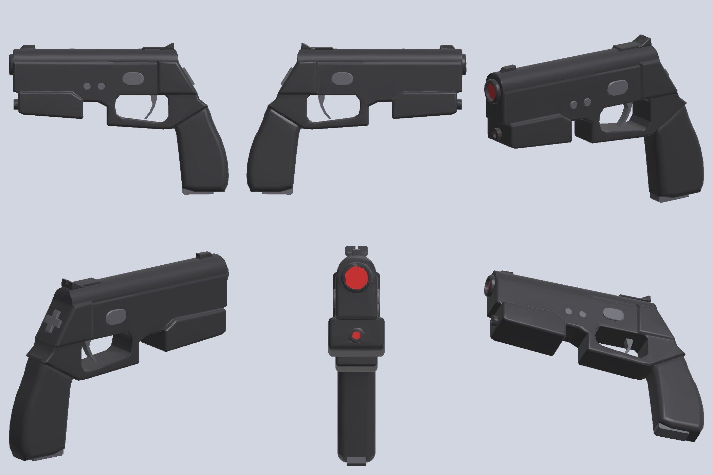

# Light gun models

The two in-game light guns are our own creations:

- `assets/lightgun.glb`, the PS1 light gun (GunCon): 2,836 triangles, about 100 KB.
- `assets/lightgun2.glb`, the PS2 light gun (GunCon 2): 3,080 triangles, about 105 KB.

Each one was drawn from public photos. The side outline was traced by hand, and `photo/` builds the solid from that outline. They use no 3D scan data. They have no logos, wordmarks, model numbers or other markings: only outlines and the positions of the controls were taken from the photos, never their surface detail.




## Rebuild

```sh
tools/lightgun/photo/run.sh guncon1 <work dir> [python]   # assets/lightgun.glb
tools/lightgun/photo/run.sh guncon2 <work dir> [python]   # assets/lightgun2.glb
```

You need Python 3.11 with `numpy scipy trimesh pymeshlab scikit-image rtree mapbox-earcut pillow`. Nothing outside the repo is needed, and the output is deterministic: a rebuild gives a byte-identical `.glb`.

| Stage | Script | What it does |
|---|---|---|
| 1 | `photo/build_body.py` | Reads the gun's outline (`photo/guncon1.json`, `photo/guncon2.json`). Extrudes each part's side polygon (slide, sights, frame, grip, front housing, and so on) to its width with rounded edges, as a signed distance field. A `crown_mm` rounds a part's top across its width. Joins the parts with 0.8 mm fillets, then cuts the trigger-guard opening, any sight notch, the bore tubes with their lens recesses and, on the PS1 gun, the raised button bosses with their sockets. Marching cubes at 0.5 mm. |
| 2 | `decimate.py` | Quadric decimation to 2,600 faces. Mean deviation from the dense solid is 0.01 mm (p95 0.06 mm). |
| 3 | `photo/guncon1_glb.py`, `photo/guncon2_glb.py` | Adds the trigger (the traced blade, extruded) and the gun's controls, seated on the body by casting rays at it, marks the bore floors as `lens`, and writes the nodes of the contract below. `photo/glb.py` holds what the two share. |
| 4 | `view_glb.py` | Reads the `.glb` back and renders the preview. Pass `pressed` as the last argument to see the trigger pulled. |

## Where the shapes come from

Both outlines are traced on [one photo](https://commons.wikimedia.org/wiki/File:GunCon_e_GunCon_2.jpg) (Eduardo Shiroma, CC BY 3.0). It shows the PS1 gun's right side and the PS2 gun's left side, both square to the camera. In the JSON files the points are pixels of that photo, after the crop given there. Edges in shadow there were checked on [a second photo](https://commons.wikimedia.org/wiki/File:GunCon_1_and_2.jpg) (public domain) of the other side of each gun.

The overall length, height and width are the real guns'. Each traced outline is scaled to its length and its height separately; on that photo the two scales agree within 3%, as close as its perspective and lens allow. The widths of the parts come from photos of the front or rear, as proportions. They are estimates, so change them in the JSON files if you have a gun to measure.

### PS1 light gun

- **Side outline.** The rear and top edges come from the main photo. The underside of the front housing and the front of the grip are in shadow there, so they come from the second photo. That photo was registered onto the first through six screw holes visible in both, with residuals under 1 mm.
- **Widths, front end, buttons.** Read off [Evan-Amos's 3/4 photo](https://commons.wikimedia.org/wiki/File:Namco-GunCon-PS1.jpg) (public domain): the two protruding bore tubes, the housing standing proud of the slide, and the round boss around each button. Both buttons are red, as on the real gun: A on the left side, B on the right.
- **Size.** 241.3 × 169.3 × 36.8 mm. Full widths: slide 30 mm, frame 30 mm, grip 32 mm, front housing 34.4 mm plus a 1.2 mm boss on each side.

### PS2 light gun

- **Side outline and controls.** From the main photo: A (the oval above the trigger), Select and Start, the D-pad on the raked rear face, and C, the piece under the front of the grip. The label beside the front button reads SELECT, which settles the order of Select and Start. The second photo (an orange gun, right side) confirms the grip's depth and C's place.
- **Widths.** The D-pad's cross spans 0.6 of the rear face's width in a photo of the rear, and about 20 mm along the raked face in the side photo. That makes the rear block 34 mm wide; the others follow in proportion: slide 32 mm with a domed top, frame 30 mm, grip 27 mm, rear-sight fin 16 mm. The front housing is the widest part, at the gun's full 40.0 mm.
- **Size.** 226.9 × 154.1 × 40.0 mm.
- **Reference only.** [BrokenSphere's photos](https://commons.wikimedia.org/wiki/File:GunCon_2_directional_pad.JPG) (CC BY-SA 3.0) of the rear and sides were looked at to see where the D-pad and C sit, and to read the cross and sight proportions above. Nothing was traced from them.

### Compared with the earlier scan-based models

Seen from the side, the PS1 gun's outline matches the scan-based model to an IoU of 0.91, and the PS2 gun's to 0.89. On both, the largest difference is the front of the grip: about 3 mm and 5 mm further back, which the second photo of each gun confirms. On the PS2 gun, the photos also disagree with the scan-based model in two places. The trigger hangs at the rear of the guard opening, not at its front. C sits under the front of the grip, not on the heel by the cable. The muzzle, the side buttons, Select, Start and the D-pad land within about 3 mm of the scan-based ones. This comparison is a check only: nothing in `photo/` is fitted to the scans.

## Contract for the host

- Units are metres. The axes follow glTF: +Y is up, −Z points forward along the bore, +X is the gun's right side.
- The root node `lightgun` has its origin at the grip centre.

| Node | Meaning |
|---|---|
| `body` | The shell, with two primitives: material `shell` and material `lens`. |
| `trigger` | Pivots at its node origin. To pull, rotate about local +X by a negative angle; about −12° of travel. |
| `button_left`, `button_right` | The side buttons: on the front housing of the PS1 gun, and above the trigger (A and B) on the PS2 gun. To press, translate about 1 mm inward along ±X. |
| `muzzle` | The aim ray starts here, on the upper bore face. The ray direction is the node's −Z. |
| `grip` | Sits at the grip centre, 55.6 mm above the butt on the PS1 gun and 42.4 mm on the PS2 gun. Local −Z runs up the grip axis, which is raked from vertical (about 14° on the PS1 gun, 7° on the PS2 gun); +Y points forward. Use it to line up with the OpenXR grip pose. |

The PS2 gun has extra controls. Each is a node whose rotation sets up a local frame: +Z points out of the gun, +Y toward its top along the surface (toward the muzzle for C), and +X to its right. The host presses them about 1 mm along local −Z, and tilts the D-pad about 6° so that the pressed edge goes in. A model without these nodes, like the PS1 gun's, simply has no such parts.

| Node | Meaning |
|---|---|
| `button_select`, `button_start` | The two small round buttons on the left side. Select is the front one. |
| `button_c` | C, under the front of the grip. Pressed up into the grip. |
| `dpad` | The D-pad on the raked rear face. Up tilts about local −X, right about local +Y. |

The materials are `shell` (near-black), `trim` (trigger and the PS2 gun's controls), `button` (red, the PS1 gun's buttons) and `lens` (dark red). The host draws the buttons and controls in its own colours.

The host loads both models and draws the one picked in Settings › Light Gun › Gun model (VR.ini `gun_model`: 0 PS1 gun, 1 GunCon2, 2 the VR controller with no gun).

## Known approximations

- Each part has a constant width, so the side faces are flat. Tapers, the grips' swell, serrations, and the decorative slots, grooves and panel lines are left out.
- The part widths and the bore diameters are estimates from photos, not measurements.
- Each trigger is its traced side profile with a constant width.

## Scan-based versions (not shipped)

The first versions of both models were rebuilt from 3D scans of the guns' plastic shells. The scans came without a licence, so those models are no longer shipped. Their pipelines are kept, and now write `assets/lightgun-scan.glb` and `assets/lightgun2-scan.glb`, so they cannot overwrite the shipped models. The scans are not in the repo. Logos and markings were removed from both: the wordmarks on the slides, the PlayStation logo, and the model/copyright text on the front housings.

```sh
tools/lightgun/run.sh "<dir with LeftScan.obj + RightScan.obj>" <work dir> [python]   # PS1 gun
tools/lightgun/guncon2/run.sh "<dir with Right.stl>" <work dir> [python]             # PS2 gun
```

They also need `shapely`. Both are deterministic: the same scans give a byte-identical `.glb`.

| Stage | Script | What it does |
|---|---|---|
| 1 | `load.py` / `guncon2/load_stl.py` | Reads each OBJ (about 1.1M vertices per shell) / a binary STL (about 2.5M triangles) and welds the vertices. |
| 2 | `align.py` / `guncon2/align.py` | PS1: flips the right shell onto the left shell's parting plane, adds 1.0 mm for the stepped lip so the muzzle bore comes out round, and registers the outlines (IoU 0.996). PS2: levels the right shell on a plane fitted to its rim and mirrors it for the left; the shells meet flush. |
| 3 | `fields.py` | Builds outer-surface height fields from ±X, ±Y and ±Z at 0.5 mm. |
| 4 | `solid.py` (+ `guncon2/markings.json`) | Fills the screw and button holes, clamps deep openings, suppresses scan detail under 0.5 mm, Laplace-fills the logo boxes, then builds the solid as the intersection of the six bounds (marching cubes). `loosen` widens the bounds across noisy side walls. |
| 5 | `decimate.py` | Quadric decimation to 2,600 faces. |
| 6 | `build_glb.py` / `guncon2/build_glb.py` | Adds the parts that are not in the scans (trigger, buttons, controls), the lens material and the marker nodes. |

Their known approximations: the trigger and buttons are hand-modelled; the PS1 gun's width depends on the inferred 1.0 mm lip offset; undercuts are approximated by the six height fields; the PS2 gun's left side is its right side mirrored.
