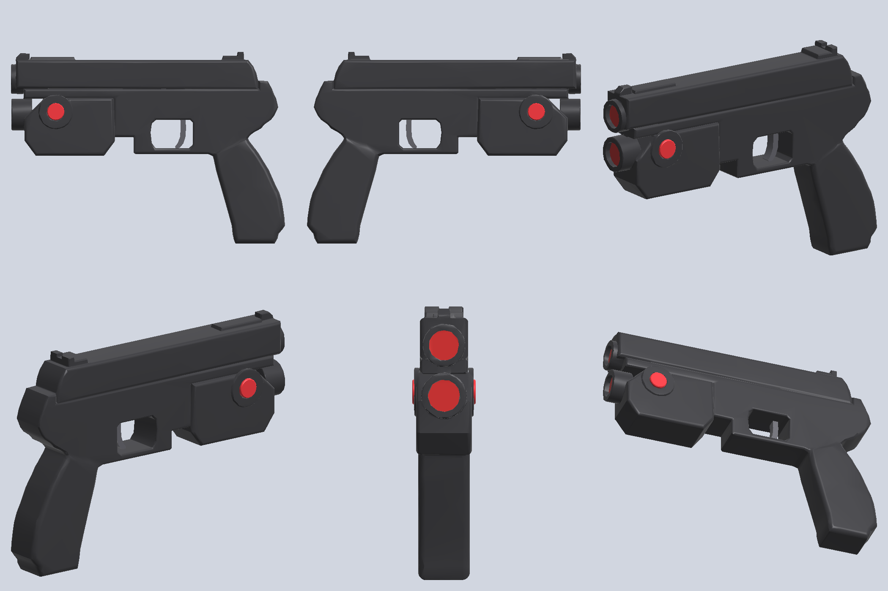
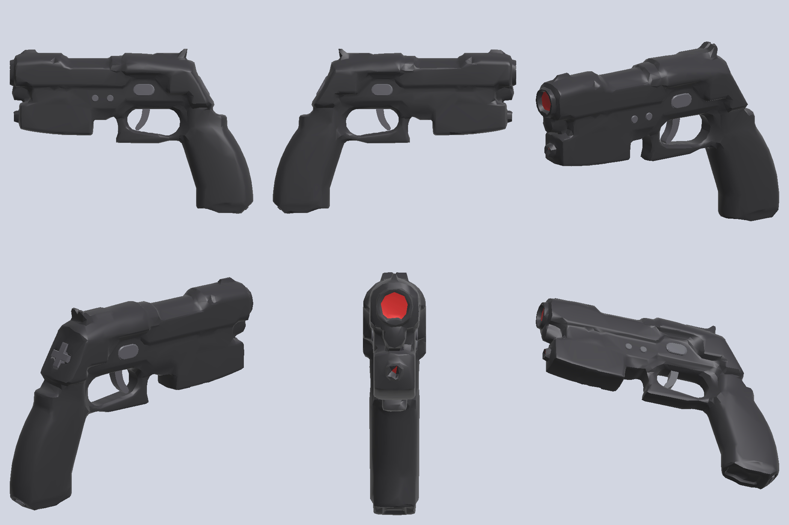

# Light gun model

`assets/lightgun.glb` is a low-poly (2,844 triangles, 92 KB) in-game model of the light gun. It is rebuilt from 3D scans of the two plastic shells of a PS1 light gun. Logos and markings are removed: the "namco" wordmarks on both sides of the slide, the PlayStation logo and wordmark above the grip, and the model/copyright text on the left front housing.



## Rebuild

```sh
tools/lightgun/run.sh "<dir with LeftScan.obj + RightScan.obj>" <work dir> [python]
```

You need Python 3.11 with `numpy scipy trimesh pymeshlab scikit-image rtree shapely mapbox-earcut pillow`. The output is deterministic: the same scans give a byte-identical `.glb`. The scans (about 400 MB) are not in the repo.

| Stage | Script | What it does |
|---|---|---|
| 1 | `load.py` | Reads each OBJ (about 1.1M vertices per shell). |
| 2 | `align.py` | Flips the right shell onto the left shell's parting plane, adds 1.0 mm for the stepped lip so the muzzle bore comes out round, and registers the outlines (IoU 0.996). |
| 3 | `fields.py` | Builds outer-surface height fields from ±X, ±Y and ±Z at 0.5 mm. |
| 4 | `solid.py` | Fills the screw and button holes, clamps deep openings, suppresses scan detail under 0.5 mm, Laplace-fills the logo boxes, then builds the solid as the intersection of the six bounds (marching cubes). |
| 5 | `decimate.py` | Quadric decimation to 2,600 faces. Mean deviation from the dense solid is 0.06 mm (p95 0.19 mm). |
| 6 | `build_glb.py` | Adds the parts that are not in the scans (trigger, side buttons), a lens material on the two front openings, and marker nodes. Writes the `.glb` with crease-split normals (35°). |
| 7 | `view_glb.py` | Reads the `.glb` back and renders the preview. Pass `pressed` as the last argument to see the trigger pulled. |

The logo boxes are in `solid.py`, as x/z ranges in mm in the scan frame. If you change the alignment, check them against a detail render of the height field. Another gun can pass its own boxes, and the other `solid.py` settings, in a JSON file (see `guncon2/markings.json`).

## Contract for the host

- Units are metres. The axes follow glTF: +Y is up, −Z points forward along the bore, +X is the gun's right side.
- The root node `lightgun` has its origin at the grip centre.

| Node | Meaning |
|---|---|
| `body` | The shell, with two primitives: material `shell` and material `lens`. |
| `trigger` | Pivots at its node origin. To pull, rotate about local +X by a negative angle; about −12° of travel. |
| `button_left`, `button_right` | The side buttons on the front housing. To press, translate about 1 mm inward. |
| `muzzle` | The aim ray starts here, on the upper bore face. The ray direction is the node's −Z. |
| `grip` | Sits at the grip centre. Local −Z runs up the grip axis, which is raked 11° from vertical; +Y points forward. Use it to line up with the OpenXR grip pose. |

The materials are `shell` (near-black), `trim` (trigger and buttons) and `lens` (dark red).

## Known approximations

- The trigger and buttons are hand-modelled, because the scans contain only the shells.
- Total width (36.8 mm) depends on the 1.0 mm lip offset, which is inferred from the bore shape, not measured.
- Undercuts are approximated: the six-direction height fields cannot represent them.
- Slide serrations and shallow decorative grooves mostly decimate away at this budget.

## GunCon2

`assets/guncon2.glb` is the same kind of model, built from a scan of the right shell of a PS2 light gun: 3,156 triangles, 116 KB, with the body at 2,600 faces like the PS1 gun. It follows the same contract, so it can replace `lightgun.glb` as it is. The left shell is the right one mirrored. Its own scan is much noisier, and the two sides differ only in things the model does not take from the scan: the left side's SELECT/START holes, and markings. The "G/C GUNCON 2" wordmark is removed from both sides of the slide, and so is the blank pad where the right side has no SELECT/START, so that those buttons sit on a flat face as on the real gun. The left scan also has a model/copyright plate on the front housing, which the mirror leaves out.



```sh
tools/lightgun/guncon2/run.sh "<dir with Right.stl>" <work dir> [python]
```

The scan is a binary STL file of about 2.5M triangles (125 MB). The pipeline reuses stages 3 to 5 and the preview, and has its own versions of the others in `guncon2/`:

| Stage | Script | What is different |
|---|---|---|
| 1 | `guncon2/load_stl.py` | Reads binary STL and welds the vertices. |
| 2 | `guncon2/align.py` | Levels the shell on a plane fitted to its rim and mirrors it for the left shell. The rims meet flush: the two scans register with an IoU of 0.997 and their cross-sections are symmetric, so there is no lip offset. The 40.1 mm width comes from the scan. |
| 4 | `solid.py` + `guncon2/markings.json` | The wordmark and pad boxes for this gun. `loosen` widens the top, bottom, front and back bounds by one cell across the side walls. Without it, the scan noise on the long vertical walls turns into streaks. |
| 6 | `guncon2/build_glb.py` | The GunCon2's controls (below). The upper bore and the small lower front opening get the lens material. |

`button_left` and `button_right` are A and B, the oval buttons above the trigger, one on each side. They follow the PS1 gun's convention: no rotation, pressed along ±X. The extra controls are nodes whose rotation sets up a local frame: +Z points out of the gun, +Y toward its top along the surface, and +X to its right. The host presses them about 1 mm along local −Z, and tilts the D-pad about 6° so that the pressed edge goes in. A model without these nodes, like the PS1 gun's, simply has no such parts.

| Node | Meaning |
|---|---|
| `button_select`, `button_start` | The two small round buttons on the left side. Select is the front one; this order has not been checked against a real gun. |
| `button_c` | C, on the 45° chamfer at the heel of the grip. |
| `dpad` | The D-pad on the raked rear face. Up tilts about local −X, right about local +Y. |

The host loads both models and draws the one picked in Settings › Light Gun › Gun model (VR.ini `gun_model`: 0 PS1 gun, 1 GunCon2, 2 the VR controller with no gun).

Known approximations: the trigger is the PS1 gun's blade, moved to fit the GunCon2's guard. The cable opening under the grip is left as a 3 mm pocket. Small asymmetries of the real shells are lost to the mirror.
