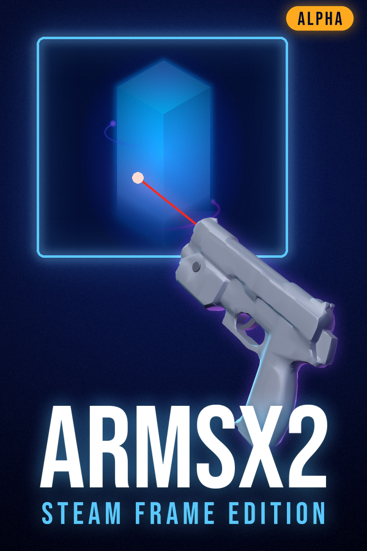

# Steam library artwork

`make_art.py` builds the Steam library images for **ARMSX2 - Steam Frame Edition** into `assets/steam/`. The installer copies them into Steam's grid folder when it adds the non-Steam shortcut. The script also writes the installer app's page images, `tools/steam-frame/installer/ui/hero.jpg` (the hero at 1500×484) and `logo.png` (the logo at 228 px tall), from the same art.

While the project is in Alpha, every image that ships has an **ALPHA** badge: `assets/steam/` and the installer page images. The same five images without the badge are written to `assets/steam-final/` on each run, ready for when the project leaves Alpha.



## Rebuild

```sh
python3 tools/steam-art/make_art.py .
```

You need Python 3 with `numpy` and `pillow`. The output is deterministic: the background grain uses a fixed seed. It takes a few seconds.

## Files and where Steam expects them

Steam keys a non-Steam shortcut's artwork by the shortcut's app ID (`<id>`, the `appid` written in `shortcuts.vdf`). The images go in `~/.local/share/Steam/userdata/<user>/config/grid/`.

| Asset | Size | Grid file name | Shown as |
|---|---|---|---|
| `capsule.png` | 600×900 | `<id>p.png` | Library capsule (portrait) |
| `wide.png` | 920×430 | `<id>.png` | Wide capsule, recent games |
| `hero.png` | 1920×620 | `<id>_hero.png` | Game page banner; has no text, because Steam draws the logo over its left side |
| `logo.png` | 1148×600 with the Alpha badge (1148×504 without), transparent | `<id>_logo.png` | Logo over the hero |
| `icon.png` | 256×256, transparent | the shortcut's `icon` field (a path) | List and game page icon |

## What goes into them

- **ARMSX2 pillar.** Cut from the ARMSX2 app icon (`external/armsx2/platforms/ios/app/src/main/assets/app_icons/icon.png`, GPLv3 with the ARMSX2 sources) and added onto the background, so its glow blends in.
- **Title font.** Bebas Neue, shipped by the ARMSX2 Android app (`res/font/bebas_neue.ttf`, SIL Open Font License 1.1). Only rendered text is in the images; the font file is not copied.
- **Light gun.** `assets/lightgun.glb`, rendered by `gun.py`. This is a numpy rasteriser with perspective, cyan and violet rim lights in the ARMSX2 palette, and emissive lenses with bloom. Each scene picks the camera roll so the bore points at the red aim dot in the window (`solve_shot`).
- **The window.** The glowing frame stands for the volumetric window the game is shown in on the Frame.
- **Alpha badge.** An amber pill reading "ALPHA" in Bebas Neue, with an amber halo (`alpha_badge`, `put_badge`). It goes in the top right corner of the capsule, the wide capsule, the hero (set in from the edges so Steam's cropping keeps it) and the icon, and under the end of "STEAM FRAME EDITION" in the logo. The `ALPHA` constant at the top of `make_art.py` turns it on.

## Leaving Alpha

Set `ALPHA = False` at the top of `make_art.py` and rerun it: `assets/steam/` and the installer page images then come out without the badge. You can also copy `assets/steam-final/*` over `assets/steam/`, but that leaves the installer page images badged. After either one, make a release (or run `deploy-to-frame.sh`) and rebuild the installer app, whose icon comes from `icon.png`.

## Changing the layout

To change the layout, edit the per-image functions (`capsule`, `wide`, `hero`, `logo`, `icon`). Each one sets the window box, the aim target, and the gun's render size and position in that image's pixels.
